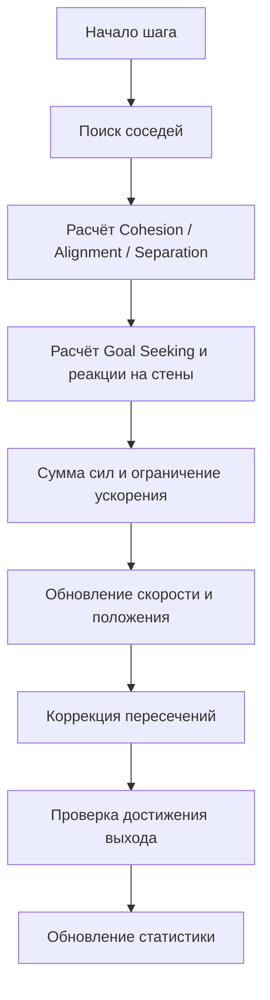

<div align="center">

# ЛАБОРАТОРНАЯ РАБОТА

## Моделирование коллективного поведения агентов

### Вариант № 3 — Моделирование движения пешеходов

**Алгоритм Boids с правилом движения к цели (Goal Seeking)**

---

**Студент:** Мартынюк Максим  
**Группа:** IA2404  
**Дисциплина:** Искусственный интеллект  
**Дата:** 30 октября 2026 г.

</div>

> **Кратко о работе.** Разработана интерактивная двумерная модель движения пешеходов из помещения через коридор и узкий выход. Поведение каждого агента определяется взаимодействием с соседями, стремлением к цели и ограничениями геометрии. На основе шести сохранённых CSV-экспериментов проведено сравнение времени выхода и локальных скоплений.

---

## 1. Цель работы

Исследовать поведение толпы в ограниченном пространстве с использованием алгоритма **Boids**, дополненного правилом **Goal Seeking**. Проверить, как количество пешеходов, плотность их начального размещения, ширина коридора и двери, а также сила разделения влияют на движение группы, появление очередей и время выхода.

## 2. Постановка задачи

Необходимо создать двумерную среду с коридором и выходом; задать набор пешеходов с начальными координатами и скоростями; на каждом шаге моделирования находить соседей, рассчитывать силы **Cohesion**, **Alignment**, **Separation** и **Goal Seeking**, суммировать их с весами и ограничивать скорость. Требуется анимация движения и фиксация времени достижения цели каждым участником.

В экспериментальной части следует сравнить сценарии с различным количеством людей, плотностью, шириной коридора, дверного проёма и силой разделения.

## 3. Модель и среда

### 3.1. Планировка

Пешеходы начинают движение в просторной левой комнате, проходят через вход в коридор, затем через более узкую дверь и достигают линии выхода справа.


Для расчётов используются координаты в **пикселях**, время измеряется в **модельных секундах**. Пешеход изображается кругом радиуса **7 px**.

### 3.2. Агенты

Каждый пешеход характеризуется:

| Поле | Содержание |
|:--|:--|
| `pid` | Уникальный номер агента |
| `x`, `y` | Положение в плоскости |
| `vx`, `vy` | Компоненты скорости |
| `exit_time` | Время достижения выхода; до выхода значение отсутствует |

Начальные позиции генерируются с учётом заданной плотности, начальные скорости равны нулю. Чтобы результаты можно было повторить, используется фиксированное случайное зерно `seed = 7`.

### 3.3. Управляемые параметры

| Параметр | Диапазон в панели | Назначение |
|:--|:--:|:--|
| Количество пешеходов | 20–80 | Размер группы |
| Начальная плотность | 0,00–1,00 | Компактность начального размещения |
| Ширина коридора | 32–250 px | Расстояние между стенами коридора |
| Ширина двери | 24–150 px | Ширина конечного проёма |
| Сила разделения | 0,00–5,00 | Интенсивность избегания соседей |

**Дополнительное ограничение:** ширина двери не может превышать ширину коридора.

Параметры движения, заданные в `Config`:

| Параметр | Значение |
|:--|--:|
| Радиус поиска соседей | 58 px |
| Радиус разделения | 22 px |
| Вес центрирования | 0,18 |
| Вес выравнивания | 0,28 |
| Вес движения к цели | 1,8 |
| Максимальная скорость | 115 px/с |
| Максимальное ускорение | 240 px/с² |
| Шаг времени | 1/30 с |
| Максимум шагов | 1800 |

## 4. Используемый алгоритм

### 4.1. Базовые правила Boids

1. **Cohesion (центрирование).** Пешеход немного корректирует движение в сторону средней позиции соседей.
2. **Alignment (выравнивание).** Пешеход стремится согласовать направление и скорость с ближайшими агентами.
3. **Separation (разделение).** При слишком близком расстоянии агент получает управляющий вектор, направленный от соседей.
4. **Goal Seeking (движение к цели).** Агент ориентируется на последовательные промежуточные точки: вход в коридор, дверь и линию выхода.

Дополнительно применяются отталкивание от стен и коррекция геометрических пересечений.

### 4.2. Расчёт движения

Суммарное управляющее воздействие представляется как взвешенная сумма:

\[
\vec a_{raw} = w_c\vec C + w_a\vec A + w_s\vec S + w_g\vec G + w_w\vec W,
\]

где `C` — центрирование, `A` — выравнивание, `S` — разделение, `G` — движение к цели, `W` — отталкивание от стен, а `w` — веса соответствующих правил.

Полученное ускорение ограничивается значением `max_acceleration`; затем обновляются скорость и положение:

\[
\vec v_{t+1}=\operatorname{limit}(\vec v_t+\vec a\Delta t, v_{max}),
\qquad
\vec p_{t+1}=\vec p_t+\vec v_{t+1}\Delta t.
\]

После предварительного обновления координат модель корректирует столкновения со стенами и контактирующими пешеходами. Такая коррекция уменьшает пересечения, но не превращает учебную модель в физически точный симулятор человеческого движения.

### 4.3. Порядок одного шага



## 5. Программная реализация

**Язык:** Python. **Графика и обработка событий:** Pygame Community Edition (`pygame-ce`). Для вычислений используются стандартные модули `math`, `random`; для сохранения статистики — `csv`.

| Компонент | Функция |
|:--|:--|
| `Config` | Хранит параметры эксперимента и движения |
| `Pedestrian` | Хранит состояние отдельного пешехода |
| `Simulation` | Создание группы, расчёт шага, статистика, экспорт |
| `ControlPanel` | Изменение параметров, проверка диапазонов, применение настроек |
| `draw()` | Отображение планировки, агентов и показателей |
| `main()` | Главный цикл приложения и обработка клавиш |

Для запуска в терминале VS Code:

```powershell
python -m pip install pygame-ce
python main.py
```

Панель содержит кнопки `−` и `+`, а также поля ручного ввода. Применение изменений перезапускает эксперимент. Клавиша **Space** управляет паузой, **R** перезапускает модель, **S** сохраняет `results.csv`.

## 6. Визуализация

Цвет пешехода показывает **локальную плотность окружения**, определяемую количеством соседей в радиусе 30 px:

| Цвет | Соседи | Значение |
|:--|:--:|:--|
| 🟢 Зелёный | 0–2 | Относительно свободное движение |
| 🟡 Жёлтый | 3–4 | Повышенная локальная плотность |
| 🔴 Красный | 5 и более | Скопление |

Эта цветовая шкала **не измеряет затор непосредственно**: плотность и остановка движения — разные признаки.

### Иллюстрация наблюдаемого сценария


*Рисунок 1 — Скриншот одного из пользовательских запусков до последней корректировки интерфейса. Видны отдельный коридор, узкая дверь и скопление людей перед проёмом. Изображение иллюстрирует поведение модели, а не окончательный дизайн интерфейса.*

## 7. Эксперименты и анализ результатов

Проведено **шесть экспериментов**. Для каждого сохранён CSV-файл (`results1.csv`–`results6.csv`) с параметрами модели, временем выхода отдельных пешеходов и итоговой статистикой. Во всех экспериментах фиксированное случайное зерно позволяло воспроизводить начальные условия. В сравнении преимущественно менялся один параметр относительно базового эксперимента № 1.

### 7.1. Параметры экспериментов

| № | Сценарий | Пешеходы | Плотность | Коридор, px | Дверь, px | Разделение |
|---:|:--|---:|---:|---:|---:|---:|
| 1 | Базовый | 40 | 0,50 | 120 | 60 | 2,50 |
| 2 | Увеличение числа пешеходов | 80 | 0,50 | 120 | 60 | 2,50 |
| 3 | Повышенная начальная плотность | 40 | 1,00 | 120 | 60 | 2,50 |
| 4 | Узкие коридор и дверь | 40 | 0,50 | 32 | 24 | 2,50 |
| 5 | Узкая дверь | 40 | 0,50 | 120 | 24 | 2,50 |
| 6 | Усиленное разделение | 40 | 0,50 | 120 | 60 | 5,00 |

### 7.2. Результаты измерений

| № | Вышли | Остались | Среднее время вышедших, с | Выход всей группы, с | Макс. очередь | Макс. соседей (30 px) | Шагов |
|---:|---:|---:|---:|:--|---:|---:|---:|
| 1 | 40 | 0 | 7,92 | 9,43 | 20 | 8 | 332 |
| 2 | 80 | 0 | 8,63 | 11,37 | 50 | 16 | 369 |
| 3 | 40 | 0 | 8,20 | 9,53 | 26 | 10 | 320 |
| 4 | 13 | 27 | 10,22 | Не завершена | 4 | 17 | 1800 |
| 5 | 5 | 35 | 7,35 | Не завершена | 36 | 18 | 1800 |
| 6 | 40 | 0 | 8,09 | 10,03 | 21 | 9 | 412 |

**Пояснение к показателям.** Среднее время рассчитано только для пешеходов, достигших выхода. Если не вышла вся группа, итоговое время эвакуации не определено. «Макс. очередь» относится к ограниченной зоне около двери; люди, ожидающие перед входом в коридор, в этот показатель могут не входить.

### 7.3. Анализ отдельных факторов

**Количество пешеходов (№ 1 и № 2).** При увеличении группы с 40 до 80 человек время выхода всей группы возросло с **9,43 до 11,37 с**, а максимальная очередь — с **20 до 50**. Следовательно, возросшая нагрузка на неизменный проход привела к более выраженным скоплениям.

**Начальная плотность (№ 1 и № 3).** При росте параметра плотности с 0,50 до 1,00 время выхода группы изменилось с **9,43 до 9,53 с**, а максимальная очередь выросла с **20 до 26**. Более компактное размещение усилило локальную концентрацию агентов, но слабо повлияло на общее время в данном запуске.

**Узкий коридор (№ 4).** При коридоре 32 px и двери 24 px за 1800 шагов вышли **13 из 40** пешеходов. Поскольку одновременно изменены и ширина коридора, и ширина двери, нельзя утверждать, что всё замедление вызвано только коридором. Небольшой показатель очереди у двери (**4**) не означает отсутствие затора: часть людей задерживается перед входом в коридор.

**Узкая дверь (№ 1 и № 5).** Уменьшение двери с 60 до 24 px при неизменном коридоре 120 px привело к тому, что за 1800 шагов вышли только **5 из 40** человек, а максимальная очередь достигла **36**. Это наиболее явный пример затора непосредственно перед дверью.

**Сила разделения (№ 1 и № 6).** Увеличение веса Separation с 2,50 до 5,00 увеличило время выхода всей группы с **9,43 до 10,03 с**. В этих условиях более сильное стремление агентов расходиться не ускорило эвакуацию.

### 7.4. Отдельно наблюдавшийся сценарий

До серии CSV-экспериментов также был зафиксирован запуск с **20 пешеходами**, плотностью **1,00**, коридором **120 px**, дверью **24 px** и весом разделения **0,00**. За **1800 шагов** вышли **10**, остались **10**; максимальная очередь составила **17**. Этот сценарий иллюстрирует возможное скопление у узкого выхода, но **не является одним из шести экспериментов в таблице 7.2**.

### 7.5. Ограничения эксперимента

- В экспериментах № 1, 2, 3 и 6 все агенты достигли выхода **раньше 500 шагов** (320–412 шагов). Если требование работы «не менее 500 шагов» относится к каждому запуску, в программе нужно дополнительно фиксировать минимум 500 шагов или провести соответствующие запуски; эти CSV сами по себе такого требования не подтверждают.
- Эксперименты № 4 и № 5 завершились по достижении предела **1800 шагов**, а не по выходу всех пешеходов.
- Каждый набор параметров исследован одним запуском; для более надёжного обобщения следует повторять испытания с разными начальными расположениями и сравнивать усреднённые значения.
- Учебная модель не учитывает особенности индивидуального человеческого поведения и не предназначена для практического расчёта эвакуационной безопасности.

## 8. Выводы

В лабораторной работе реализована двумерная симуляция движения пешеходов на основе алгоритма **Boids** с правилами центрирования, выравнивания, разделения и движения к цели (**Goal Seeking**). Программа моделирует прохождение группы из помещения через коридор и дверь, визуализирует локальную плотность, учитывает геометрические ограничения и сохраняет статистику в CSV.

На основе **шести реальных запусков** установлено:

1. Удвоение количества пешеходов с 40 до 80 увеличило время выхода всей группы с **9,43 до 11,37 с** и максимальную очередь с **20 до 50**.
2. Увеличение начальной плотности с 0,50 до 1,00 повысило максимальную очередь с **20 до 26**, при этом время выхода изменилось незначительно.
3. Узкая дверь 24 px при коридоре 120 px привела к выраженному затору: за 1800 шагов вышли только **5 из 40** человек.
4. При одновременном сужении коридора до 32 px и двери до 24 px вышли **13 из 40** человек; для отдельной оценки влияния коридора нужен дополнительный опыт с неизменной шириной двери.
5. Повышение веса разделения с 2,50 до 5,00 увеличило время эвакуации с **9,43 до 10,03 с**, поэтому более сильное отталкивание не всегда улучшает прохождение группы.

**Итог:** поведение толпы определяется сочетанием коллективных правил Boids и ограничений пространства. Особенно существенным фактором в полученных данных оказалась ширина дверного проёма. Полученная программа подходит для учебного изучения скоплений и пропускной способности, но не заменяет профессиональные модели безопасной эвакуации.

---

<div align="center">

*Конец отчёта · Вариант № 3 · Boids для пешеходов*

</div>
