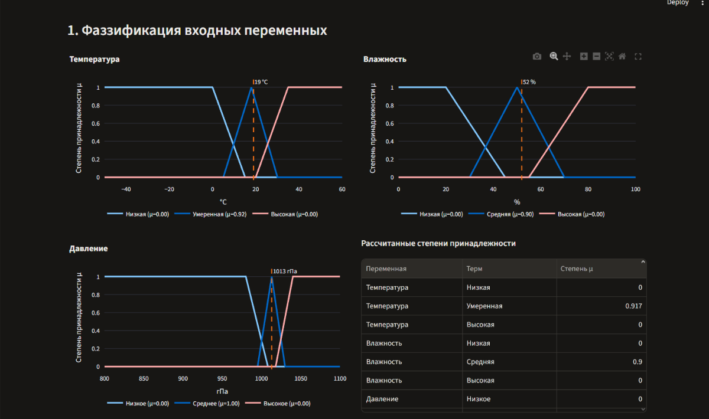
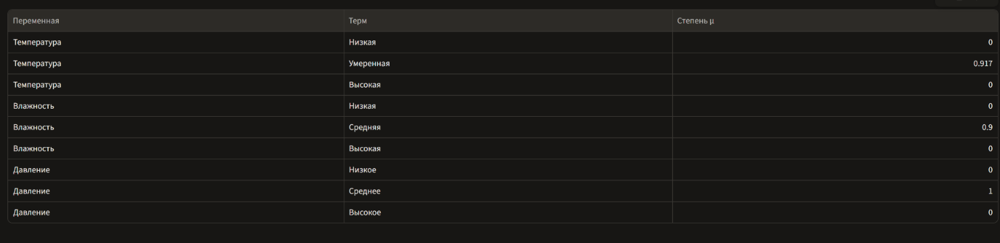
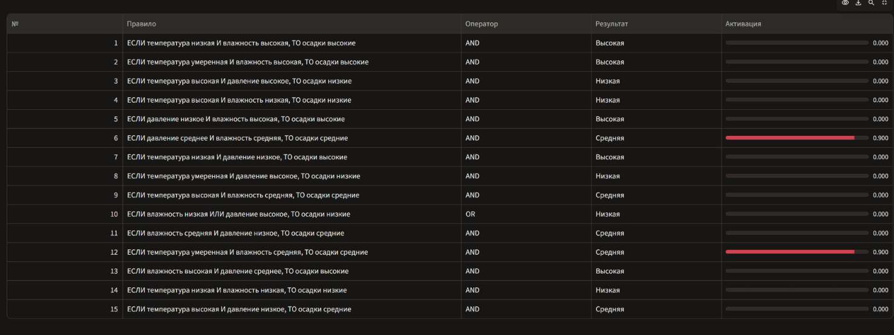
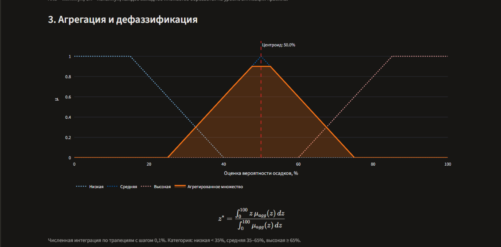
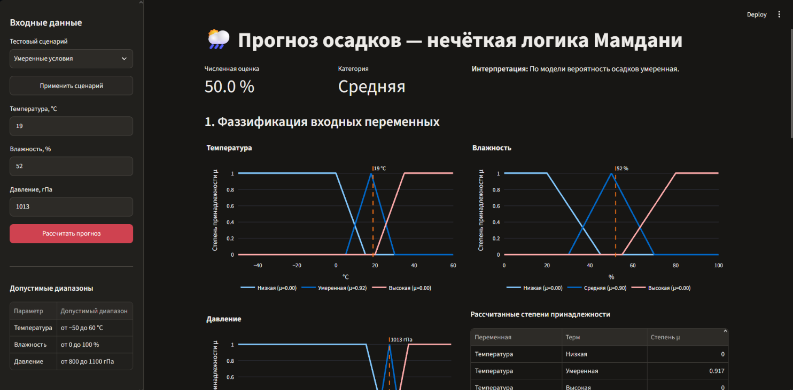
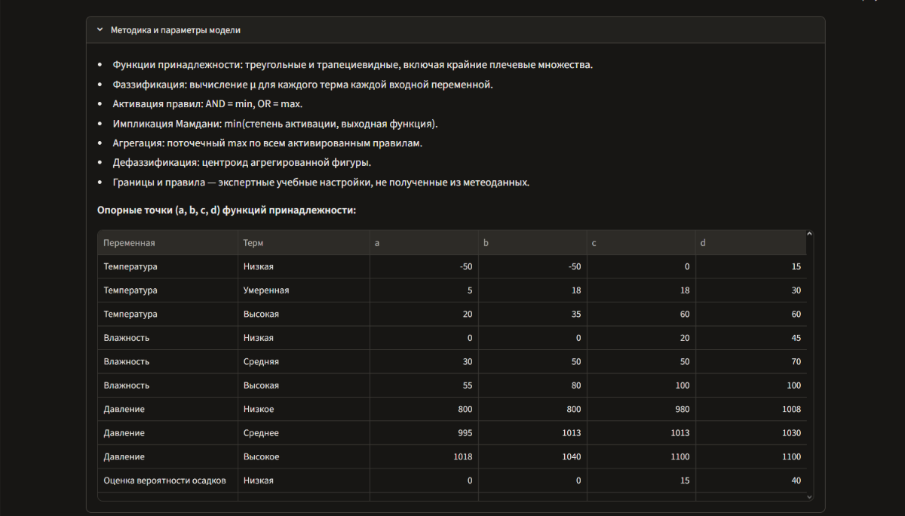
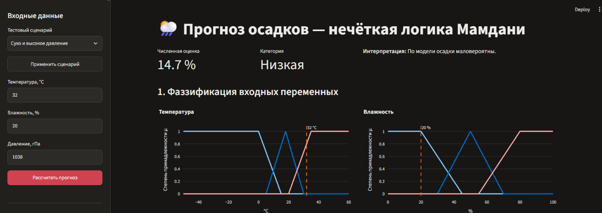
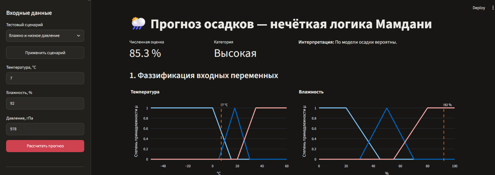

# Лабораторная работа №4 — Нечёткая система прогнозирования осадков

**Вариант №1. Прогнозирование погодных условий**  
**Студент:** Мартынюк Петр
**Группа:** IA-2404  
**Дисциплина:**  Искусственный интеллект

## 1. Цель работы

Разработать интерактивную экспертную систему на основе нечёткого вывода Мамдани для оценки вероятности осадков по температуре воздуха, относительной влажности и атмосферному давлению. Реализовать фаззификацию, правила IF–THEN с операторами AND/OR, агрегацию нечётких выводов и дефаззификацию методом центроида. Предусмотреть визуализацию и повторный расчёт без перезапуска приложения.

## 2. Описание предметной области

Осадки зависят от многих атмосферных процессов, однако для учебной экспертной системы рассмотрены три наблюдаемых параметра: температура, влажность и давление. Переходы между оценками «низкая», «средняя» и «высокая» описываются пересекающимися нечёткими множествами. Благодаря этому одно значение может одновременно принадлежать нескольким категориям.

**Ограничение:** возвращаемый процент — численная оценка модели Мамдани на шкале от 0 до 100, а не статистически откалиброванная метеорологическая вероятность. Приложение работает автономно и не обращается к погодным API.

## 3. Входные и выходные переменные

| Переменная | Диапазон | Лингвистические значения |
|---|---|---|
| Температура | −50…60 °C | низкая, умеренная, высокая |
| Относительная влажность | 0…100 % | низкая, средняя, высокая |
| Атмосферное давление | 800…1100 гПа | низкое, среднее, высокое |
| Оценка вероятности осадков | 0…100 % | низкая, средняя, высокая |

Для задания нечётких множеств используются треугольные и трапециевидные функции принадлежности. Их параметры `(a, b, c, d)` приведены ниже.

**Таблица 1 — Опорные точки функций принадлежности**

| Переменная | Терм | a | b | c | d |
|---|---|---:|---:|---:|---:|
| Температура | Низкая | -50 | -50 | 0 | 15 |
| Температура | Умеренная | 5 | 18 | 18 | 30 |
| Температура | Высокая | 20 | 35 | 60 | 60 |
| Влажность | Низкая | 0 | 0 | 20 | 45 |
| Влажность | Средняя | 30 | 50 | 50 | 70 |
| Влажность | Высокая | 55 | 80 | 100 | 100 |
| Давление | Низкое | 800 | 800 | 980 | 1008 |
| Давление | Среднее | 995 | 1013 | 1013 | 1030 |
| Давление | Высокое | 1018 | 1040 | 1100 | 1100 |
| Оценка вероятности осадков | Низкая | 0 | 0 | 15 | 40 |
| Оценка вероятности осадков | Средняя | 25 | 50 | 50 | 75 |
| Оценка вероятности осадков | Высокая | 60 | 85 | 100 | 100 |

Крайние множества являются «плечевыми»: на части области их степень принадлежности сохраняется равной единице. Треугольное множество задаётся совпадающими точками `b = c`.

## 4. Язык программирования, технологии и библиотеки

- **Python 3.10+** — язык разработки;
- **Streamlit** — интерактивный веб-интерфейс;
- **NumPy** — вычисление степеней принадлежности, операции над массивами, интегрирование;
- **Plotly** — интерактивные графики;
- **pandas** — табличное представление результатов;
- **unittest** — автоматическая проверка модели.

## 5. Функции принадлежности и фаззификация

Фаззификация преобразует каждое точное входное значение в степени принадлежности μ от 0 до 1. Для трапециевидной функции используется выражение:

$$
\mu(x)=\min\left(L(x),R(x)\right),\quad
L(x)=\begin{cases}1,&a=b\\\max(0,\min(1,\frac{x-a}{b-a})),&a\ne b\end{cases},\quad
R(x)=\begin{cases}1,&c=d\\\max(0,\min(1,\frac{d-x}{d-c})),&c\ne d\end{cases}.
$$

**Листинг 1 — Вычисление трапециевидной функции принадлежности (`fuzzy_model.py`)**

```python
def trapezoid(x: Any, a: float, b: float, c: float, d: float) -> np.ndarray:
    x = np.asarray(x, dtype=float)
    left = np.ones_like(x) if a == b else np.clip((x - a) / (b - a), 0, 1)
    right = np.ones_like(x) if c == d else np.clip((d - x) / (d - c), 0, 1)
    return np.minimum(left, right)


def memberships(variable: str, values: Any) -> dict[str, np.ndarray]:
    return {name: trapezoid(values, *points) for name, points in SETS[variable].items()}
```

На рисунке 1 представлены три входные функции принадлежности и рассчитанные степени принадлежности для умеренных условий (19 °C, 52%, 1013 гПа).



*Рисунок 1 — Графики функций принадлежности входных переменных и таблица фаззификации.*

Для приведённого сценария температура принадлежит терму «умеренная» примерно на **0,917**, влажность терму «средняя» на **0,900**, давление терму «среднее» на **1,000**. Это видно также в таблице степеней принадлежности на рисунке 2.



*Рисунок 2 — Степени принадлежности для умеренных погодных условий.*

## 6. База нечётких правил IF–THEN

В системе предусмотрено **15 правил**, что превышает минимальное требование в 9. В условиях используются AND и OR. Таблица 2 содержит полный набор правил, реализованный в файле `fuzzy_model.py`.

**Таблица 2 — База правил Мамдани**

| № | Правило | Оператор | Выходной терм |
|---:|---|---|---|
| 1 | температура низкая И влажность высокая → высокие | AND | Высокая |
| 2 | температура умеренная И влажность высокая → высокие | AND | Высокая |
| 3 | температура высокая И давление высокое → низкие | AND | Низкая |
| 4 | температура высокая И влажность низкая → низкие | AND | Низкая |
| 5 | давление низкое И влажность высокая → высокие | AND | Высокая |
| 6 | давление среднее И влажность средняя → средние | AND | Средняя |
| 7 | температура низкая И давление низкое → высокие | AND | Высокая |
| 8 | температура умеренная И давление высокое → низкие | AND | Низкая |
| 9 | температура высокая И влажность средняя → средние | AND | Средняя |
| 10 | влажность низкая ИЛИ давление высокое → низкие | OR | Низкая |
| 11 | влажность средняя И давление низкое → средние | AND | Средняя |
| 12 | температура умеренная И влажность средняя → средние | AND | Средняя |
| 13 | влажность высокая И давление среднее → высокие | AND | Высокая |
| 14 | температура низкая И влажность низкая → низкие | AND | Низкая |
| 15 | температура высокая И давление низкое → средние | AND | Средняя |

**Листинг 2 — Примеры представления правил**

```python
Rule(1, 'ЕСЛИ температура низкая И влажность высокая, ТО осадки высокие',
     (('temperature', 'Низкая'), ('humidity', 'Высокая')), 'AND', 'Высокая')
Rule(10, 'ЕСЛИ влажность низкая ИЛИ давление высокое, ТО осадки низкие',
     (('humidity', 'Низкая'), ('pressure', 'Высокое')), 'OR', 'Низкая')
```

Как показано на рисунке 3, для умеренного сценария правила №6 и №12 активируются со степенью 0,900, остальные не срабатывают. Система отображает все 15 правил, включая неактивные.



*Рисунок 3 — Таблица IF–THEN правил и степень их активации.*

## 7. Алгоритм нечёткого вывода Мамдани

Вычисление состоит из пяти последовательных этапов:

1. **Фаззификация:** определяются μ для входных значений.
2. **Активация правил:** для AND применяется минимум, для OR — максимум:  
   `α = min(μ₁, μ₂)` или `α = max(μ₁, μ₂)`.
3. **Импликация:** выходное нечёткое множество правила обрезается на высоте активации: `μᵢ(z) = min(αᵢ, μвыход(z))`.
4. **Агрегация:** результаты правил объединяются поточечным максимумом: `μagg(z) = maxᵢ μᵢ(z)`.
5. **Дефаззификация:** численный результат определяется центроидом итогового нечёткого множества.

**Листинг 3 — Активация, импликация и агрегация (`fuzzy_model.py`)**

```python
for rule in RULES:
    strengths = [fuzzy_inputs[var][term] for var, term in rule.terms]
    strength = min(strengths) if rule.operator == 'AND' else max(strengths)
    clipped = np.minimum(strength, base_outputs[rule.output])
    aggregated = np.maximum(aggregated, clipped)
```

**Метод центроида:**

$$
z^*=\frac{\int_0^{100} z\,\mu_{agg}(z)\,dz}{\int_0^{100}\mu_{agg}(z)\,dz}
$$

**Листинг 4 — Численная дефаззификация**

```python
area = float(np.trapezoid(aggregated, output_x))
if area < 1e-12:
    raise ValueError('Ни одно правило не сработало — для данного ввода результат не определён.')
result = float(np.trapezoid(output_x * aggregated, output_x) / area)
```

Интегрирование выполняется методом трапеций по 1001 точке от 0 до 100 с шагом 0,1. На рисунке 4 показано агрегированное нечёткое множество умеренного сценария: его центр тяжести расположен в **50,0%**.



*Рисунок 4 — Дефаззификация методом центроида.*

Пороговая интерпретация численного результата: менее 35% — **низкая**; от 35% до менее 65% — **средняя**; 65% и выше — **высокая**.

## 8. Описание интерфейса пользователя

Интерфейс построен с помощью Streamlit. В боковой панели расположены список готовых сценариев, поля температуры, влажности и давления, кнопка расчёта и таблица допустимых диапазонов. В основной области выводятся число, категория, интерпретация, интерактивные графики и таблица правил.

На рисунке 5 показан общий вид интерфейса в сценарии «Умеренные условия».



*Рисунок 5 — Основное окно приложения при температуре 19 °C, влажности 52% и давлении 1013 гПа.*

После ручного изменения параметра сценарий переключается на «Пользовательские значения». Перерасчёт выполняется нажатием «Рассчитать прогноз» без перезапуска. Также доступно пояснение этапов вычисления и таблица опорных точек, показанная на рисунке 6.



*Рисунок 6 — Параметры функций принадлежности и описание метода.*

**Листинг 5 — Обработка пустых и некорректных значений (`app.py`)**

```python
def parse_value(label: str, raw: str) -> float:
    if raw is None or str(raw).strip() == '':
        raise ValueError(f'{label}: поле не должно быть пустым.')
    normalized = str(raw).strip().replace(',', '.')
    try:
        return float(normalized)
    except ValueError as exc:
        raise ValueError(f'{label}: введите число.') from exc
```

Функция `validate_inputs()` дополнительно проверяет диапазон каждого параметра и запрещает нечисловые и бесконечные значения, включая `NaN`.

## 9. Примеры тестовых сценариев

Для проверки работы модели выбраны три набора входных значений, соответствующие низкой, высокой и средней оценке осадков.

**Таблица 3 — Результаты тестирования**

| Сценарий | Температура | Влажность | Давление | Результат | Категория |
|---|---:|---:|---:|---:|---|
| Сухо и высокое давление | 32 °C | 20 % | 1038 гПа | 14.7 % | Низкая |
| Влажно и низкое давление | 7 °C | 92 % | 978 гПа | 85.3 % | Высокая |
| Умеренные условия | 19 °C | 52 % | 1013 гПа | 50.0 % | Средняя |

### Сценарий 1. Сухая погода

При высокой температуре (32 °C), низкой влажности (20%) и высоком давлении (1038 гПа) модель получает **14.7%**, категория — **низкая**. На рисунке 7 представлен результат расчёта.



*Рисунок 7 — Сухая погода и высокое давление.*

### Сценарий 2. Влажная погода

При температуре 7 °C, влажности 92% и давлении 978 гПа активируются правила, связанные с высокой влажностью и низким давлением. Результат — **85.3%**, категория — **высокая** (рисунок 8).



*Рисунок 8 — Высокая влажность и низкое давление.*

### Сценарий 3. Умеренная погода

Температура 19 °C, влажность 52%, давление 1013 гПа. Значения главным образом принадлежат средним термам; активируются правила №6 и №12 с силой 0,900. После объединения правил выходное множество симметрично относительно 50%, поэтому центроид равен **50.0%** (рисунки 3–5).

## 10. Результаты работы программы

Программа принимает числовые параметры, вычисляет их степени принадлежности, определяет активные правила и возвращает агрегированное нечёткое множество с численным центроидом. Для каждого сценария результат сопровождается категорией и текстовой интерпретацией. Все три требуемые ситуации продемонстрированы на рисунках 5, 7 и 8.

Дополнительно реализованы:

- повторный расчёт без перезапуска приложения;
- ручной ввод с автоматическим переключением сценария;
- обработка пустых, текстовых и выходящих за пределы значений;
- отображение активации всех правил;
- графическое отображение центроида и опорных функций.

## 11. Анализ полученных результатов

Сравнение таблицы 3 демонстрирует, что при снижении влажности и повышении давления оценка осадков уменьшается, тогда как при высокой влажности и низком давлении увеличивается. Для промежуточных условий результат попадает в среднюю категорию. Такие зависимости следуют из базы заданных экспертных правил.

Перекрывающиеся функции принадлежности дают плавный переход между категориями: близкие входные значения могут одновременно активировать несколько правил с различной силой. Это отличается от обычной жёсткой классификации. Например, при 19 °C степень принадлежности к «умеренной» температуре составляет около 0,917, а при 52% влажности к «средней» — 0,900 (рисунок 1).

Вместе с тем достоверность фактического прогноза погоды не оценивалась. Набор из трёх переменных и 15 экспертных правил достаточен для демонстрации метода Мамдани, но недостаточен для профессионального прогноза осадков. Выходные проценты следует трактовать как балльную оценку на заданной шкале, а не частоту выпадения осадков в реальности.

## 12. Вывод

В ходе лабораторной работы разработана интерактивная нечёткая экспертная система прогноза осадков по варианту №1. Реализованы три входные переменные, одна выходная переменная, 15 правил IF–THEN с AND/OR, фаззификация, импликация и агрегация Мамдани, дефаззификация центроидом, визуализация функций принадлежности, повторный запуск расчёта и проверка входных данных. В трёх тестовых сценариях получены низкая, средняя и высокая оценки, соответствующие выбранной базе правил. Поставленная учебная цель достигнута.

## 13. Установка и запуск

1. Установить Python 3.10 или новее.
2. Открыть каталог проекта в терминале.
3. Установить библиотеки:

   ```powershell
   python -m pip install -r requirements.txt
   ```

4. Запустить Streamlit:

   ```powershell
   python -m streamlit run app.py
   ```

5. Открыть адрес `http://localhost:8501` (обычно открывается автоматически).

Для автоматической проверки:

```powershell
python -m unittest -v
```

## 14. Структура проекта

```text
Weather_Mamdani_Lab4/
├── README.md
├── app.py
├── fuzzy_model.py
├── test_model.py
├── requirements.txt
└── Images/
    ├── 01_main.png
    ├── 02_memberships.png
    ├── 03_rules.png
    ├── 04_degrees.png
    ├── 05_centroid.png
    ├── 06_parameters.png
    ├── 07_dry.png
    └── 08_wet.png
```

> **Важно для GitHub:** папка `Images` должна находиться рядом с `README.md`. Изображения вставлены относительными Markdown-путями ``, поэтому отображаются непосредственно на странице репозитория. Не загружайте только `README.md` без папки `Images`.
