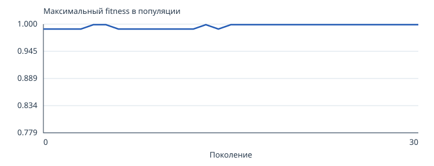
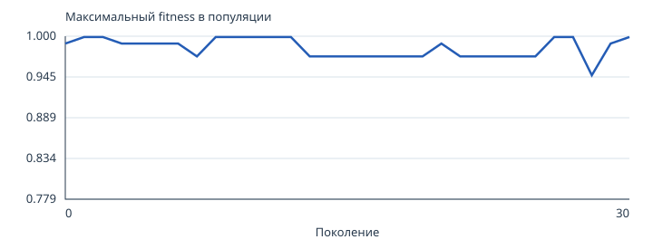

<div align="center">

Молдавский государственный университет

Дисциплина «Искусственный интеллект»

# Лабораторная работа №5

## Реализация и исследование параметров генетического алгоритма

Вариант 7

Выполнил Петр Мартынюк, группа IA2404

Кишинёв, 2026

</div>

## Цель работы

Реализовать генетический алгоритм для максимизации функции одной переменной и экспериментально исследовать влияние вероятностей кроссовера и мутации и размера популяции на поиск.

## Целевая функция

Для варианта 7 задана функция $f(x)=e^{-(x-0.5)^2}$, где $0\le x\le1$. Приспособленность особи равна значению этой функции. На непрерывном отрезке максимум равен 1 при $x=0.5$. После дискретизации ближайшие значения — $7/15$ и $8/15$. Они равноудалены от 0.5 и дают один и тот же точный максимум сетки $e^{-1/900}\approx0.99888951$. Этот эталон используется при оценке экспериментов.

## Язык программирования и технологии

Реализация написана на Python. Использованы стандартные модули `argparse` для настройки, `random` для стохастических операций, `math` и `statistics` для вычислений, `csv` и `pathlib` для сохранения данных. Графики строятся в SVG из значений журнала. [Исходный код](main.py)

Для запуска из корня репозитория нужен Python 3.10 или новее. Внешних зависимостей нет.

```sh
python Lab5/main.py --experiments --output Lab5/results
python Lab5/main.py --population 5 --pc 0.8 --pm 0.05 --generations 30 --seed 23 --output Lab5/results/custom
```

## Кодирование хромосомы

Фиксированные четыре бита кодируют целое $b$ от 0 до 15, которое декодируется по формуле $x=b/15$. Например, `1000` даёт $8/15$. В программе хромосома хранится как целое число, а журнал и таблицы сохраняют также её четырёхбитное представление.

Функция приспособленности вычисляется в точке, закодированной хромосомой.

```python
def fitness(gene):
    return math.exp(-(gene / LIMIT - 0.5) ** 2)
```

## Операторы генетического алгоритма

1. Инициализация. Каждая из $N$ хромосом независимо получает равномерно случайное значение от 0 до 15. Это даёт алгоритму разные начальные области поиска.
2. Селекция. Для каждого родителя случайно выбираются две особи с возвращением. Побеждает особь с большей приспособленностью. Турнир работает и с отрицательным fitness и сохраняет возможность выбора менее приспособленных особей.
3. Кроссовер. С вероятностью $p_c$ выбирается один из трёх разрезов и родители обмениваются суффиксами. Это позволяет комбинировать биты двух родителей.
4. Мутация. Каждый бит каждого сохраняемого потомка инвертируется независимо с вероятностью $p_m$. Это позволяет вернуть утраченные значения генов.
5. Замещение. Потомки полностью заменяют популяцию. При нечётном $N$ используется только первый потомок последней пары. Лучшая встреченная особь сохраняется отдельно для итогового ответа. Максимум отдельного поколения может снижаться.
6. Остановка. Программа оценивает начальное поколение 0 и выполняет $G$ циклов эволюции, затем оценивает поколение $G$ без создания новых потомков.

Кроссовер обменивает суффиксы после выбранной точки. Мутация инвертирует биты через XOR.

```python
if rng.random() < pc:
    point = rng.randrange(1, L)
    mask = (1 << (L - point)) - 1
    left, right = (left & ~mask) | (right & mask), (right & ~mask) | (left & mask)
    print(f"  Кроссовер: да, после бита {point}, потомки {left:04b}, {right:04b}", file=log)
```

```python
for bit in range(1, L + 1):
    if rng.random() < pm:
        mask = 1 << (L - bit)
        previous = int(bool(child & mask))
        child ^= mask
        changed.append(f"бит {bit}: {previous} → {1-previous}")
```

## Параметры экспериментов

Во всех запусках $L=4$, $G=30$, seed = 23. Первые три запуска имеют одинаковую начальную популяцию. Четвёртый меняет $N$ при тех же вероятностях, что в первом.

| Эксперимент | N | pc | pm |
|---|---:|---:|---:|
| 1 | 4 | 0.80 | 0.05 |
| 2 | 4 | 0.40 | 0.01 |
| 3 | 4 | 0.90 | 0.15 |
| 4 | 12 | 0.80 | 0.05 |

## Логи работы программы

Полные журналы включают популяцию и fitness каждой особи, номера родителей, факт и точку кроссовера, изменённые биты и сводку по каждому поколению. Итог последнего поколения содержит лучшую найденную хромосому за весь запуск.

Фрагмент фактического журнала первого эксперимента.

```text
Поколение 0
  Особь 1: 1001, b=9, x=0.60000000, fitness=0.99004983
  Особь 2: 0010, b=2, x=0.13333333, fitness=0.87420144
  Особь 3: 0000, b=0, x=0.00000000, fitness=0.77880078
  Особь 4: 1001, b=9, x=0.60000000, fitness=0.99004983
  min=0.77880078, mean=0.90827547, max=0.99004983
  Селекция: особи №2 и №1
  Кроссовер: да, после бита 1, потомки 0001, 1010
  Мутация, особь №1: нет
  Мутация, особь №2: бит 2: 0 → 1
```

[Эксперимент 1](results/exp1/operations.txt) · [Эксперимент 2](results/exp2/operations.txt) · [Эксперимент 3](results/exp3/operations.txt) · [Эксперимент 4](results/exp4/operations.txt)

## Таблицы эволюции популяции

Начальное поколение первого эксперимента.

| Поколение | Особь | Хромосома | b | x | f(x) |
|---:|---:|---|---:|---:|---:|
| 0 | 1 | 1001 | 9 | 0.60000000 | 0.99004983 |
| 0 | 2 | 0010 | 2 | 0.13333333 | 0.87420144 |
| 0 | 3 | 0000 | 0 | 0.00000000 | 0.77880078 |
| 0 | 4 | 1001 | 9 | 0.60000000 | 0.99004983 |

Полные таблицы по каждому запуску.

| Эксперимент | Все хромосомы, x и f(x) | Минимум, среднее и максимум по поколениям |
|---|---|---|
| 1 | [124 записи](results/exp1/evolution.csv) | [Поколения 0–30](results/exp1/statistics.csv) |
| 2 | [124 записи](results/exp2/evolution.csv) | [Поколения 0–30](results/exp2/statistics.csv) |
| 3 | [124 записи](results/exp3/evolution.csv) | [Поколения 0–30](results/exp3/statistics.csv) |
| 4 | [372 записи](results/exp4/evolution.csv) | [Поколения 0–30](results/exp4/statistics.csv) |

### Максимальный fitness по поколениям

| Поколение | Эксп. 1 | Эксп. 2 | Эксп. 3 | Эксп. 4 |
| --- | --- | --- | --- | --- |
| 0 | 0.99004983 | 0.99004983 | 0.99004983 | 0.99888951 |
| 1 | 0.99004983 | 0.99004983 | 0.99888951 | 0.99888951 |
| 2 | 0.99004983 | 0.99004983 | 0.99888951 | 0.99888951 |
| 3 | 0.99004983 | 0.99004983 | 0.99004983 | 0.99888951 |
| 4 | 0.99888951 | 0.99004983 | 0.99004983 | 0.99888951 |
| 5 | 0.99888951 | 0.99004983 | 0.99004983 | 0.99888951 |
| 6 | 0.99004983 | 0.99004983 | 0.99004983 | 0.99888951 |
| 7 | 0.99004983 | 0.99888951 | 0.97260448 | 0.99888951 |
| 8 | 0.99004983 | 0.99888951 | 0.99888951 | 0.99888951 |
| 9 | 0.99004983 | 0.99888951 | 0.99888951 | 0.99888951 |
| 10 | 0.99004983 | 0.99888951 | 0.99888951 | 0.99888951 |
| 11 | 0.99004983 | 0.99888951 | 0.99888951 | 0.99888951 |
| 12 | 0.99004983 | 0.99888951 | 0.99888951 | 0.99888951 |
| 13 | 0.99888951 | 0.99888951 | 0.97260448 | 0.99888951 |
| 14 | 0.99004983 | 0.99888951 | 0.97260448 | 0.99888951 |
| 15 | 0.99888951 | 0.99888951 | 0.97260448 | 0.99888951 |
| 16 | 0.99888951 | 0.99888951 | 0.97260448 | 0.99888951 |
| 17 | 0.99888951 | 0.99888951 | 0.97260448 | 0.99888951 |
| 18 | 0.99888951 | 0.99888951 | 0.97260448 | 0.99888951 |
| 19 | 0.99888951 | 0.99888951 | 0.97260448 | 0.99888951 |
| 20 | 0.99888951 | 0.99888951 | 0.99004983 | 0.99888951 |
| 21 | 0.99888951 | 0.99888951 | 0.97260448 | 0.99888951 |
| 22 | 0.99888951 | 0.99888951 | 0.97260448 | 0.99888951 |
| 23 | 0.99888951 | 0.99888951 | 0.97260448 | 0.99888951 |
| 24 | 0.99888951 | 0.99888951 | 0.97260448 | 0.99888951 |
| 25 | 0.99888951 | 0.99888951 | 0.97260448 | 0.99888951 |
| 26 | 0.99888951 | 0.99888951 | 0.99888951 | 0.99888951 |
| 27 | 0.99888951 | 0.99888951 | 0.99888951 | 0.99888951 |
| 28 | 0.99888951 | 0.99888951 | 0.94701112 | 0.99888951 |
| 29 | 0.99888951 | 0.99888951 | 0.99004983 | 0.99888951 |
| 30 | 0.99888951 | 0.99888951 | 0.99888951 | 0.99888951 |

### Статистика популяций в последнем поколении

| Эксперимент | Минимум | Среднее | Максимум |
| --- | --- | --- | --- |
| 1 | 0.87420144 | 0.96114623 | 0.99888951 |
| 2 | 0.91393119 | 0.97764993 | 0.99888951 |
| 3 | 0.99004983 | 0.99225975 | 0.99888951 |
| 4 | 0.97260448 | 0.99669909 | 0.99888951 |

<details>
<summary>Эксперимент 1. Все особи и статистика поколений</summary>

| Поколение | Особь | Хромосома | b | x | f(x) |
| --- | --- | --- | --- | --- | --- |
| 0 | 1 | 1001 | 9 | 0.60000000 | 0.99004983 |
| 0 | 2 | 0010 | 2 | 0.13333333 | 0.87420144 |
| 0 | 3 | 0000 | 0 | 0.00000000 | 0.77880078 |
| 0 | 4 | 1001 | 9 | 0.60000000 | 0.99004983 |
| 1 | 1 | 0001 | 1 | 0.06666667 | 0.82879886 |
| 1 | 2 | 1110 | 14 | 0.93333333 | 0.82879886 |
| 1 | 3 | 1001 | 9 | 0.60000000 | 0.99004983 |
| 1 | 4 | 1001 | 9 | 0.60000000 | 0.99004983 |
| 2 | 1 | 1001 | 9 | 0.60000000 | 0.99004983 |
| 2 | 2 | 1001 | 9 | 0.60000000 | 0.99004983 |
| 2 | 3 | 1001 | 9 | 0.60000000 | 0.99004983 |
| 2 | 4 | 1001 | 9 | 0.60000000 | 0.99004983 |
| 3 | 1 | 1001 | 9 | 0.60000000 | 0.99004983 |
| 3 | 2 | 0001 | 1 | 0.06666667 | 0.82879886 |
| 3 | 3 | 0000 | 0 | 0.00000000 | 0.77880078 |
| 3 | 4 | 1001 | 9 | 0.60000000 | 0.99004983 |
| 4 | 1 | 1000 | 8 | 0.53333333 | 0.99888951 |
| 4 | 2 | 0001 | 1 | 0.06666667 | 0.82879886 |
| 4 | 3 | 1001 | 9 | 0.60000000 | 0.99004983 |
| 4 | 4 | 0001 | 1 | 0.06666667 | 0.82879886 |
| 5 | 1 | 1000 | 8 | 0.53333333 | 0.99888951 |
| 5 | 2 | 1001 | 9 | 0.60000000 | 0.99004983 |
| 5 | 3 | 1001 | 9 | 0.60000000 | 0.99004983 |
| 5 | 4 | 1001 | 9 | 0.60000000 | 0.99004983 |
| 6 | 1 | 1001 | 9 | 0.60000000 | 0.99004983 |
| 6 | 2 | 1001 | 9 | 0.60000000 | 0.99004983 |
| 6 | 3 | 1101 | 13 | 0.86666667 | 0.87420144 |
| 6 | 4 | 1001 | 9 | 0.60000000 | 0.99004983 |
| 7 | 1 | 1001 | 9 | 0.60000000 | 0.99004983 |
| 7 | 2 | 1001 | 9 | 0.60000000 | 0.99004983 |
| 7 | 3 | 1001 | 9 | 0.60000000 | 0.99004983 |
| 7 | 4 | 1001 | 9 | 0.60000000 | 0.99004983 |
| 8 | 1 | 1101 | 13 | 0.86666667 | 0.87420144 |
| 8 | 2 | 1001 | 9 | 0.60000000 | 0.99004983 |
| 8 | 3 | 1001 | 9 | 0.60000000 | 0.99004983 |
| 8 | 4 | 1001 | 9 | 0.60000000 | 0.99004983 |
| 9 | 1 | 1001 | 9 | 0.60000000 | 0.99004983 |
| 9 | 2 | 1001 | 9 | 0.60000000 | 0.99004983 |
| 9 | 3 | 1011 | 11 | 0.73333333 | 0.94701112 |
| 9 | 4 | 1001 | 9 | 0.60000000 | 0.99004983 |
| 10 | 1 | 1001 | 9 | 0.60000000 | 0.99004983 |
| 10 | 2 | 1001 | 9 | 0.60000000 | 0.99004983 |
| 10 | 3 | 1001 | 9 | 0.60000000 | 0.99004983 |
| 10 | 4 | 1001 | 9 | 0.60000000 | 0.99004983 |
| 11 | 1 | 1001 | 9 | 0.60000000 | 0.99004983 |
| 11 | 2 | 1001 | 9 | 0.60000000 | 0.99004983 |
| 11 | 3 | 1001 | 9 | 0.60000000 | 0.99004983 |
| 11 | 4 | 1001 | 9 | 0.60000000 | 0.99004983 |
| 12 | 1 | 1001 | 9 | 0.60000000 | 0.99004983 |
| 12 | 2 | 1001 | 9 | 0.60000000 | 0.99004983 |
| 12 | 3 | 1001 | 9 | 0.60000000 | 0.99004983 |
| 12 | 4 | 1001 | 9 | 0.60000000 | 0.99004983 |
| 13 | 1 | 1001 | 9 | 0.60000000 | 0.99004983 |
| 13 | 2 | 1000 | 8 | 0.53333333 | 0.99888951 |
| 13 | 3 | 1001 | 9 | 0.60000000 | 0.99004983 |
| 13 | 4 | 1001 | 9 | 0.60000000 | 0.99004983 |
| 14 | 1 | 1001 | 9 | 0.60000000 | 0.99004983 |
| 14 | 2 | 1001 | 9 | 0.60000000 | 0.99004983 |
| 14 | 3 | 1001 | 9 | 0.60000000 | 0.99004983 |
| 14 | 4 | 1001 | 9 | 0.60000000 | 0.99004983 |
| 15 | 1 | 1001 | 9 | 0.60000000 | 0.99004983 |
| 15 | 2 | 1001 | 9 | 0.60000000 | 0.99004983 |
| 15 | 3 | 1000 | 8 | 0.53333333 | 0.99888951 |
| 15 | 4 | 0001 | 1 | 0.06666667 | 0.82879886 |
| 16 | 1 | 1000 | 8 | 0.53333333 | 0.99888951 |
| 16 | 2 | 1011 | 11 | 0.73333333 | 0.94701112 |
| 16 | 3 | 1001 | 9 | 0.60000000 | 0.99004983 |
| 16 | 4 | 1000 | 8 | 0.53333333 | 0.99888951 |
| 17 | 1 | 1000 | 8 | 0.53333333 | 0.99888951 |
| 17 | 2 | 1001 | 9 | 0.60000000 | 0.99004983 |
| 17 | 3 | 1000 | 8 | 0.53333333 | 0.99888951 |
| 17 | 4 | 1000 | 8 | 0.53333333 | 0.99888951 |
| 18 | 1 | 1000 | 8 | 0.53333333 | 0.99888951 |
| 18 | 2 | 1000 | 8 | 0.53333333 | 0.99888951 |
| 18 | 3 | 1000 | 8 | 0.53333333 | 0.99888951 |
| 18 | 4 | 1000 | 8 | 0.53333333 | 0.99888951 |
| 19 | 1 | 1000 | 8 | 0.53333333 | 0.99888951 |
| 19 | 2 | 1000 | 8 | 0.53333333 | 0.99888951 |
| 19 | 3 | 1000 | 8 | 0.53333333 | 0.99888951 |
| 19 | 4 | 1000 | 8 | 0.53333333 | 0.99888951 |
| 20 | 1 | 1000 | 8 | 0.53333333 | 0.99888951 |
| 20 | 2 | 1100 | 12 | 0.80000000 | 0.91393119 |
| 20 | 3 | 1000 | 8 | 0.53333333 | 0.99888951 |
| 20 | 4 | 1000 | 8 | 0.53333333 | 0.99888951 |
| 21 | 1 | 1000 | 8 | 0.53333333 | 0.99888951 |
| 21 | 2 | 1000 | 8 | 0.53333333 | 0.99888951 |
| 21 | 3 | 1101 | 13 | 0.86666667 | 0.87420144 |
| 21 | 4 | 1000 | 8 | 0.53333333 | 0.99888951 |
| 22 | 1 | 0000 | 0 | 0.00000000 | 0.77880078 |
| 22 | 2 | 1000 | 8 | 0.53333333 | 0.99888951 |
| 22 | 3 | 1000 | 8 | 0.53333333 | 0.99888951 |
| 22 | 4 | 1000 | 8 | 0.53333333 | 0.99888951 |
| 23 | 1 | 1000 | 8 | 0.53333333 | 0.99888951 |
| 23 | 2 | 1000 | 8 | 0.53333333 | 0.99888951 |
| 23 | 3 | 1010 | 10 | 0.66666667 | 0.97260448 |
| 23 | 4 | 1000 | 8 | 0.53333333 | 0.99888951 |
| 24 | 1 | 1000 | 8 | 0.53333333 | 0.99888951 |
| 24 | 2 | 1000 | 8 | 0.53333333 | 0.99888951 |
| 24 | 3 | 1000 | 8 | 0.53333333 | 0.99888951 |
| 24 | 4 | 1000 | 8 | 0.53333333 | 0.99888951 |
| 25 | 1 | 1100 | 12 | 0.80000000 | 0.91393119 |
| 25 | 2 | 1000 | 8 | 0.53333333 | 0.99888951 |
| 25 | 3 | 1000 | 8 | 0.53333333 | 0.99888951 |
| 25 | 4 | 1000 | 8 | 0.53333333 | 0.99888951 |
| 26 | 1 | 1000 | 8 | 0.53333333 | 0.99888951 |
| 26 | 2 | 1000 | 8 | 0.53333333 | 0.99888951 |
| 26 | 3 | 1000 | 8 | 0.53333333 | 0.99888951 |
| 26 | 4 | 1000 | 8 | 0.53333333 | 0.99888951 |
| 27 | 1 | 1000 | 8 | 0.53333333 | 0.99888951 |
| 27 | 2 | 1000 | 8 | 0.53333333 | 0.99888951 |
| 27 | 3 | 1000 | 8 | 0.53333333 | 0.99888951 |
| 27 | 4 | 1000 | 8 | 0.53333333 | 0.99888951 |
| 28 | 1 | 1000 | 8 | 0.53333333 | 0.99888951 |
| 28 | 2 | 1000 | 8 | 0.53333333 | 0.99888951 |
| 28 | 3 | 1000 | 8 | 0.53333333 | 0.99888951 |
| 28 | 4 | 1000 | 8 | 0.53333333 | 0.99888951 |
| 29 | 1 | 1000 | 8 | 0.53333333 | 0.99888951 |
| 29 | 2 | 1000 | 8 | 0.53333333 | 0.99888951 |
| 29 | 3 | 1000 | 8 | 0.53333333 | 0.99888951 |
| 29 | 4 | 1000 | 8 | 0.53333333 | 0.99888951 |
| 30 | 1 | 1010 | 10 | 0.66666667 | 0.97260448 |
| 30 | 2 | 1000 | 8 | 0.53333333 | 0.99888951 |
| 30 | 3 | 1000 | 8 | 0.53333333 | 0.99888951 |
| 30 | 4 | 0010 | 2 | 0.13333333 | 0.87420144 |

| Поколение | Минимум | Среднее | Максимум |
| --- | --- | --- | --- |
| 0 | 0.77880078 | 0.90827547 | 0.99004983 |
| 1 | 0.82879886 | 0.90942435 | 0.99004983 |
| 2 | 0.99004983 | 0.99004983 | 0.99004983 |
| 3 | 0.77880078 | 0.89692483 | 0.99004983 |
| 4 | 0.82879886 | 0.91163427 | 0.99888951 |
| 5 | 0.99004983 | 0.99225975 | 0.99888951 |
| 6 | 0.87420144 | 0.96108774 | 0.99004983 |
| 7 | 0.99004983 | 0.99004983 | 0.99004983 |
| 8 | 0.87420144 | 0.96108774 | 0.99004983 |
| 9 | 0.94701112 | 0.97929016 | 0.99004983 |
| 10 | 0.99004983 | 0.99004983 | 0.99004983 |
| 11 | 0.99004983 | 0.99004983 | 0.99004983 |
| 12 | 0.99004983 | 0.99004983 | 0.99004983 |
| 13 | 0.99004983 | 0.99225975 | 0.99888951 |
| 14 | 0.99004983 | 0.99004983 | 0.99004983 |
| 15 | 0.82879886 | 0.95194701 | 0.99888951 |
| 16 | 0.94701112 | 0.98370999 | 0.99888951 |
| 17 | 0.99004983 | 0.99667959 | 0.99888951 |
| 18 | 0.99888951 | 0.99888951 | 0.99888951 |
| 19 | 0.99888951 | 0.99888951 | 0.99888951 |
| 20 | 0.91393119 | 0.97764993 | 0.99888951 |
| 21 | 0.87420144 | 0.96771749 | 0.99888951 |
| 22 | 0.77880078 | 0.94386733 | 0.99888951 |
| 23 | 0.97260448 | 0.99231825 | 0.99888951 |
| 24 | 0.99888951 | 0.99888951 | 0.99888951 |
| 25 | 0.91393119 | 0.97764993 | 0.99888951 |
| 26 | 0.99888951 | 0.99888951 | 0.99888951 |
| 27 | 0.99888951 | 0.99888951 | 0.99888951 |
| 28 | 0.99888951 | 0.99888951 | 0.99888951 |
| 29 | 0.99888951 | 0.99888951 | 0.99888951 |
| 30 | 0.87420144 | 0.96114623 | 0.99888951 |

</details>

<details>
<summary>Эксперимент 2. Все особи и статистика поколений</summary>

| Поколение | Особь | Хромосома | b | x | f(x) |
| --- | --- | --- | --- | --- | --- |
| 0 | 1 | 1001 | 9 | 0.60000000 | 0.99004983 |
| 0 | 2 | 0010 | 2 | 0.13333333 | 0.87420144 |
| 0 | 3 | 0000 | 0 | 0.00000000 | 0.77880078 |
| 0 | 4 | 1001 | 9 | 0.60000000 | 0.99004983 |
| 1 | 1 | 0010 | 2 | 0.13333333 | 0.87420144 |
| 1 | 2 | 1001 | 9 | 0.60000000 | 0.99004983 |
| 1 | 3 | 1001 | 9 | 0.60000000 | 0.99004983 |
| 1 | 4 | 1001 | 9 | 0.60000000 | 0.99004983 |
| 2 | 1 | 1001 | 9 | 0.60000000 | 0.99004983 |
| 2 | 2 | 1001 | 9 | 0.60000000 | 0.99004983 |
| 2 | 3 | 1001 | 9 | 0.60000000 | 0.99004983 |
| 2 | 4 | 1001 | 9 | 0.60000000 | 0.99004983 |
| 3 | 1 | 1001 | 9 | 0.60000000 | 0.99004983 |
| 3 | 2 | 1001 | 9 | 0.60000000 | 0.99004983 |
| 3 | 3 | 1001 | 9 | 0.60000000 | 0.99004983 |
| 3 | 4 | 1001 | 9 | 0.60000000 | 0.99004983 |
| 4 | 1 | 1001 | 9 | 0.60000000 | 0.99004983 |
| 4 | 2 | 1001 | 9 | 0.60000000 | 0.99004983 |
| 4 | 3 | 1001 | 9 | 0.60000000 | 0.99004983 |
| 4 | 4 | 1001 | 9 | 0.60000000 | 0.99004983 |
| 5 | 1 | 1001 | 9 | 0.60000000 | 0.99004983 |
| 5 | 2 | 1001 | 9 | 0.60000000 | 0.99004983 |
| 5 | 3 | 1001 | 9 | 0.60000000 | 0.99004983 |
| 5 | 4 | 1001 | 9 | 0.60000000 | 0.99004983 |
| 6 | 1 | 1001 | 9 | 0.60000000 | 0.99004983 |
| 6 | 2 | 1001 | 9 | 0.60000000 | 0.99004983 |
| 6 | 3 | 1001 | 9 | 0.60000000 | 0.99004983 |
| 6 | 4 | 1001 | 9 | 0.60000000 | 0.99004983 |
| 7 | 1 | 1001 | 9 | 0.60000000 | 0.99004983 |
| 7 | 2 | 1000 | 8 | 0.53333333 | 0.99888951 |
| 7 | 3 | 1001 | 9 | 0.60000000 | 0.99004983 |
| 7 | 4 | 1001 | 9 | 0.60000000 | 0.99004983 |
| 8 | 1 | 1001 | 9 | 0.60000000 | 0.99004983 |
| 8 | 2 | 1000 | 8 | 0.53333333 | 0.99888951 |
| 8 | 3 | 1000 | 8 | 0.53333333 | 0.99888951 |
| 8 | 4 | 1000 | 8 | 0.53333333 | 0.99888951 |
| 9 | 1 | 1000 | 8 | 0.53333333 | 0.99888951 |
| 9 | 2 | 1000 | 8 | 0.53333333 | 0.99888951 |
| 9 | 3 | 1000 | 8 | 0.53333333 | 0.99888951 |
| 9 | 4 | 1000 | 8 | 0.53333333 | 0.99888951 |
| 10 | 1 | 1000 | 8 | 0.53333333 | 0.99888951 |
| 10 | 2 | 1000 | 8 | 0.53333333 | 0.99888951 |
| 10 | 3 | 1010 | 10 | 0.66666667 | 0.97260448 |
| 10 | 4 | 1000 | 8 | 0.53333333 | 0.99888951 |
| 11 | 1 | 1000 | 8 | 0.53333333 | 0.99888951 |
| 11 | 2 | 1000 | 8 | 0.53333333 | 0.99888951 |
| 11 | 3 | 1000 | 8 | 0.53333333 | 0.99888951 |
| 11 | 4 | 1000 | 8 | 0.53333333 | 0.99888951 |
| 12 | 1 | 1000 | 8 | 0.53333333 | 0.99888951 |
| 12 | 2 | 1000 | 8 | 0.53333333 | 0.99888951 |
| 12 | 3 | 1000 | 8 | 0.53333333 | 0.99888951 |
| 12 | 4 | 1000 | 8 | 0.53333333 | 0.99888951 |
| 13 | 1 | 1000 | 8 | 0.53333333 | 0.99888951 |
| 13 | 2 | 1010 | 10 | 0.66666667 | 0.97260448 |
| 13 | 3 | 1000 | 8 | 0.53333333 | 0.99888951 |
| 13 | 4 | 1000 | 8 | 0.53333333 | 0.99888951 |
| 14 | 1 | 1000 | 8 | 0.53333333 | 0.99888951 |
| 14 | 2 | 1000 | 8 | 0.53333333 | 0.99888951 |
| 14 | 3 | 1000 | 8 | 0.53333333 | 0.99888951 |
| 14 | 4 | 1000 | 8 | 0.53333333 | 0.99888951 |
| 15 | 1 | 1000 | 8 | 0.53333333 | 0.99888951 |
| 15 | 2 | 1000 | 8 | 0.53333333 | 0.99888951 |
| 15 | 3 | 1000 | 8 | 0.53333333 | 0.99888951 |
| 15 | 4 | 1000 | 8 | 0.53333333 | 0.99888951 |
| 16 | 1 | 1000 | 8 | 0.53333333 | 0.99888951 |
| 16 | 2 | 1000 | 8 | 0.53333333 | 0.99888951 |
| 16 | 3 | 1000 | 8 | 0.53333333 | 0.99888951 |
| 16 | 4 | 1000 | 8 | 0.53333333 | 0.99888951 |
| 17 | 1 | 1000 | 8 | 0.53333333 | 0.99888951 |
| 17 | 2 | 1000 | 8 | 0.53333333 | 0.99888951 |
| 17 | 3 | 1000 | 8 | 0.53333333 | 0.99888951 |
| 17 | 4 | 1000 | 8 | 0.53333333 | 0.99888951 |
| 18 | 1 | 1000 | 8 | 0.53333333 | 0.99888951 |
| 18 | 2 | 1000 | 8 | 0.53333333 | 0.99888951 |
| 18 | 3 | 1000 | 8 | 0.53333333 | 0.99888951 |
| 18 | 4 | 1000 | 8 | 0.53333333 | 0.99888951 |
| 19 | 1 | 1000 | 8 | 0.53333333 | 0.99888951 |
| 19 | 2 | 1000 | 8 | 0.53333333 | 0.99888951 |
| 19 | 3 | 1000 | 8 | 0.53333333 | 0.99888951 |
| 19 | 4 | 1000 | 8 | 0.53333333 | 0.99888951 |
| 20 | 1 | 1000 | 8 | 0.53333333 | 0.99888951 |
| 20 | 2 | 1000 | 8 | 0.53333333 | 0.99888951 |
| 20 | 3 | 1000 | 8 | 0.53333333 | 0.99888951 |
| 20 | 4 | 0000 | 0 | 0.00000000 | 0.77880078 |
| 21 | 1 | 0000 | 0 | 0.00000000 | 0.77880078 |
| 21 | 2 | 1000 | 8 | 0.53333333 | 0.99888951 |
| 21 | 3 | 1000 | 8 | 0.53333333 | 0.99888951 |
| 21 | 4 | 1000 | 8 | 0.53333333 | 0.99888951 |
| 22 | 1 | 0000 | 0 | 0.00000000 | 0.77880078 |
| 22 | 2 | 1001 | 9 | 0.60000000 | 0.99004983 |
| 22 | 3 | 0000 | 0 | 0.00000000 | 0.77880078 |
| 22 | 4 | 1000 | 8 | 0.53333333 | 0.99888951 |
| 23 | 1 | 1001 | 9 | 0.60000000 | 0.99004983 |
| 23 | 2 | 1000 | 8 | 0.53333333 | 0.99888951 |
| 23 | 3 | 1000 | 8 | 0.53333333 | 0.99888951 |
| 23 | 4 | 1000 | 8 | 0.53333333 | 0.99888951 |
| 24 | 1 | 1001 | 9 | 0.60000000 | 0.99004983 |
| 24 | 2 | 1000 | 8 | 0.53333333 | 0.99888951 |
| 24 | 3 | 1000 | 8 | 0.53333333 | 0.99888951 |
| 24 | 4 | 1000 | 8 | 0.53333333 | 0.99888951 |
| 25 | 1 | 1000 | 8 | 0.53333333 | 0.99888951 |
| 25 | 2 | 1000 | 8 | 0.53333333 | 0.99888951 |
| 25 | 3 | 1000 | 8 | 0.53333333 | 0.99888951 |
| 25 | 4 | 1000 | 8 | 0.53333333 | 0.99888951 |
| 26 | 1 | 1000 | 8 | 0.53333333 | 0.99888951 |
| 26 | 2 | 1000 | 8 | 0.53333333 | 0.99888951 |
| 26 | 3 | 1000 | 8 | 0.53333333 | 0.99888951 |
| 26 | 4 | 1000 | 8 | 0.53333333 | 0.99888951 |
| 27 | 1 | 1000 | 8 | 0.53333333 | 0.99888951 |
| 27 | 2 | 1000 | 8 | 0.53333333 | 0.99888951 |
| 27 | 3 | 1000 | 8 | 0.53333333 | 0.99888951 |
| 27 | 4 | 1000 | 8 | 0.53333333 | 0.99888951 |
| 28 | 1 | 1000 | 8 | 0.53333333 | 0.99888951 |
| 28 | 2 | 1000 | 8 | 0.53333333 | 0.99888951 |
| 28 | 3 | 1000 | 8 | 0.53333333 | 0.99888951 |
| 28 | 4 | 1000 | 8 | 0.53333333 | 0.99888951 |
| 29 | 1 | 1000 | 8 | 0.53333333 | 0.99888951 |
| 29 | 2 | 1000 | 8 | 0.53333333 | 0.99888951 |
| 29 | 3 | 1000 | 8 | 0.53333333 | 0.99888951 |
| 29 | 4 | 1000 | 8 | 0.53333333 | 0.99888951 |
| 30 | 1 | 1100 | 12 | 0.80000000 | 0.91393119 |
| 30 | 2 | 1000 | 8 | 0.53333333 | 0.99888951 |
| 30 | 3 | 1000 | 8 | 0.53333333 | 0.99888951 |
| 30 | 4 | 1000 | 8 | 0.53333333 | 0.99888951 |

| Поколение | Минимум | Среднее | Максимум |
| --- | --- | --- | --- |
| 0 | 0.77880078 | 0.90827547 | 0.99004983 |
| 1 | 0.87420144 | 0.96108774 | 0.99004983 |
| 2 | 0.99004983 | 0.99004983 | 0.99004983 |
| 3 | 0.99004983 | 0.99004983 | 0.99004983 |
| 4 | 0.99004983 | 0.99004983 | 0.99004983 |
| 5 | 0.99004983 | 0.99004983 | 0.99004983 |
| 6 | 0.99004983 | 0.99004983 | 0.99004983 |
| 7 | 0.99004983 | 0.99225975 | 0.99888951 |
| 8 | 0.99004983 | 0.99667959 | 0.99888951 |
| 9 | 0.99888951 | 0.99888951 | 0.99888951 |
| 10 | 0.97260448 | 0.99231825 | 0.99888951 |
| 11 | 0.99888951 | 0.99888951 | 0.99888951 |
| 12 | 0.99888951 | 0.99888951 | 0.99888951 |
| 13 | 0.97260448 | 0.99231825 | 0.99888951 |
| 14 | 0.99888951 | 0.99888951 | 0.99888951 |
| 15 | 0.99888951 | 0.99888951 | 0.99888951 |
| 16 | 0.99888951 | 0.99888951 | 0.99888951 |
| 17 | 0.99888951 | 0.99888951 | 0.99888951 |
| 18 | 0.99888951 | 0.99888951 | 0.99888951 |
| 19 | 0.99888951 | 0.99888951 | 0.99888951 |
| 20 | 0.77880078 | 0.94386733 | 0.99888951 |
| 21 | 0.77880078 | 0.94386733 | 0.99888951 |
| 22 | 0.77880078 | 0.88663523 | 0.99888951 |
| 23 | 0.99004983 | 0.99667959 | 0.99888951 |
| 24 | 0.99004983 | 0.99667959 | 0.99888951 |
| 25 | 0.99888951 | 0.99888951 | 0.99888951 |
| 26 | 0.99888951 | 0.99888951 | 0.99888951 |
| 27 | 0.99888951 | 0.99888951 | 0.99888951 |
| 28 | 0.99888951 | 0.99888951 | 0.99888951 |
| 29 | 0.99888951 | 0.99888951 | 0.99888951 |
| 30 | 0.91393119 | 0.97764993 | 0.99888951 |

</details>

<details>
<summary>Эксперимент 3. Все особи и статистика поколений</summary>

| Поколение | Особь | Хромосома | b | x | f(x) |
| --- | --- | --- | --- | --- | --- |
| 0 | 1 | 1001 | 9 | 0.60000000 | 0.99004983 |
| 0 | 2 | 0010 | 2 | 0.13333333 | 0.87420144 |
| 0 | 3 | 0000 | 0 | 0.00000000 | 0.77880078 |
| 0 | 4 | 1001 | 9 | 0.60000000 | 0.99004983 |
| 1 | 1 | 0011 | 3 | 0.20000000 | 0.91393119 |
| 1 | 2 | 1110 | 14 | 0.93333333 | 0.82879886 |
| 1 | 3 | 1001 | 9 | 0.60000000 | 0.99004983 |
| 1 | 4 | 1000 | 8 | 0.53333333 | 0.99888951 |
| 2 | 1 | 1001 | 9 | 0.60000000 | 0.99004983 |
| 2 | 2 | 1101 | 13 | 0.86666667 | 0.87420144 |
| 2 | 3 | 1000 | 8 | 0.53333333 | 0.99888951 |
| 2 | 4 | 0011 | 3 | 0.20000000 | 0.91393119 |
| 3 | 1 | 1110 | 14 | 0.93333333 | 0.82879886 |
| 3 | 2 | 0001 | 1 | 0.06666667 | 0.82879886 |
| 3 | 3 | 1001 | 9 | 0.60000000 | 0.99004983 |
| 3 | 4 | 1011 | 11 | 0.73333333 | 0.94701112 |
| 4 | 1 | 0001 | 1 | 0.06666667 | 0.82879886 |
| 4 | 2 | 1001 | 9 | 0.60000000 | 0.99004983 |
| 4 | 3 | 1001 | 9 | 0.60000000 | 0.99004983 |
| 4 | 4 | 1011 | 11 | 0.73333333 | 0.94701112 |
| 5 | 1 | 0101 | 5 | 0.33333333 | 0.97260448 |
| 5 | 2 | 1001 | 9 | 0.60000000 | 0.99004983 |
| 5 | 3 | 1001 | 9 | 0.60000000 | 0.99004983 |
| 5 | 4 | 1101 | 13 | 0.86666667 | 0.87420144 |
| 6 | 1 | 1101 | 13 | 0.86666667 | 0.87420144 |
| 6 | 2 | 0001 | 1 | 0.06666667 | 0.82879886 |
| 6 | 3 | 1001 | 9 | 0.60000000 | 0.99004983 |
| 6 | 4 | 1011 | 11 | 0.73333333 | 0.94701112 |
| 7 | 1 | 1010 | 10 | 0.66666667 | 0.97260448 |
| 7 | 2 | 1111 | 15 | 1.00000000 | 0.77880078 |
| 7 | 3 | 0101 | 5 | 0.33333333 | 0.97260448 |
| 7 | 4 | 1111 | 15 | 1.00000000 | 0.77880078 |
| 8 | 1 | 0111 | 7 | 0.46666667 | 0.99888951 |
| 8 | 2 | 1011 | 11 | 0.73333333 | 0.94701112 |
| 8 | 3 | 1010 | 10 | 0.66666667 | 0.97260448 |
| 8 | 4 | 1010 | 10 | 0.66666667 | 0.97260448 |
| 9 | 1 | 1000 | 8 | 0.53333333 | 0.99888951 |
| 9 | 2 | 1000 | 8 | 0.53333333 | 0.99888951 |
| 9 | 3 | 0111 | 7 | 0.46666667 | 0.99888951 |
| 9 | 4 | 0011 | 3 | 0.20000000 | 0.91393119 |
| 10 | 1 | 1000 | 8 | 0.53333333 | 0.99888951 |
| 10 | 2 | 1000 | 8 | 0.53333333 | 0.99888951 |
| 10 | 3 | 1000 | 8 | 0.53333333 | 0.99888951 |
| 10 | 4 | 1001 | 9 | 0.60000000 | 0.99004983 |
| 11 | 1 | 1000 | 8 | 0.53333333 | 0.99888951 |
| 11 | 2 | 0101 | 5 | 0.33333333 | 0.97260448 |
| 11 | 3 | 1000 | 8 | 0.53333333 | 0.99888951 |
| 11 | 4 | 1100 | 12 | 0.80000000 | 0.91393119 |
| 12 | 1 | 1000 | 8 | 0.53333333 | 0.99888951 |
| 12 | 2 | 1001 | 9 | 0.60000000 | 0.99004983 |
| 12 | 3 | 0100 | 4 | 0.26666667 | 0.94701112 |
| 12 | 4 | 1011 | 11 | 0.73333333 | 0.94701112 |
| 13 | 1 | 1010 | 10 | 0.66666667 | 0.97260448 |
| 13 | 2 | 1111 | 15 | 1.00000000 | 0.77880078 |
| 13 | 3 | 0000 | 0 | 0.00000000 | 0.77880078 |
| 13 | 4 | 1111 | 15 | 1.00000000 | 0.77880078 |
| 14 | 1 | 1010 | 10 | 0.66666667 | 0.97260448 |
| 14 | 2 | 1010 | 10 | 0.66666667 | 0.97260448 |
| 14 | 3 | 1110 | 14 | 0.93333333 | 0.82879886 |
| 14 | 4 | 1011 | 11 | 0.73333333 | 0.94701112 |
| 15 | 1 | 1010 | 10 | 0.66666667 | 0.97260448 |
| 15 | 2 | 0010 | 2 | 0.13333333 | 0.87420144 |
| 15 | 3 | 1010 | 10 | 0.66666667 | 0.97260448 |
| 15 | 4 | 1110 | 14 | 0.93333333 | 0.82879886 |
| 16 | 1 | 1110 | 14 | 0.93333333 | 0.82879886 |
| 16 | 2 | 1110 | 14 | 0.93333333 | 0.82879886 |
| 16 | 3 | 1011 | 11 | 0.73333333 | 0.94701112 |
| 16 | 4 | 1010 | 10 | 0.66666667 | 0.97260448 |
| 17 | 1 | 1010 | 10 | 0.66666667 | 0.97260448 |
| 17 | 2 | 1011 | 11 | 0.73333333 | 0.94701112 |
| 17 | 3 | 1111 | 15 | 1.00000000 | 0.77880078 |
| 17 | 4 | 1010 | 10 | 0.66666667 | 0.97260448 |
| 18 | 1 | 1010 | 10 | 0.66666667 | 0.97260448 |
| 18 | 2 | 0011 | 3 | 0.20000000 | 0.91393119 |
| 18 | 3 | 1011 | 11 | 0.73333333 | 0.94701112 |
| 18 | 4 | 0011 | 3 | 0.20000000 | 0.91393119 |
| 19 | 1 | 1011 | 11 | 0.73333333 | 0.94701112 |
| 19 | 2 | 0010 | 2 | 0.13333333 | 0.87420144 |
| 19 | 3 | 1011 | 11 | 0.73333333 | 0.94701112 |
| 19 | 4 | 1010 | 10 | 0.66666667 | 0.97260448 |
| 20 | 1 | 1010 | 10 | 0.66666667 | 0.97260448 |
| 20 | 2 | 1001 | 9 | 0.60000000 | 0.99004983 |
| 20 | 3 | 1011 | 11 | 0.73333333 | 0.94701112 |
| 20 | 4 | 1010 | 10 | 0.66666667 | 0.97260448 |
| 21 | 1 | 1010 | 10 | 0.66666667 | 0.97260448 |
| 21 | 2 | 1011 | 11 | 0.73333333 | 0.94701112 |
| 21 | 3 | 1011 | 11 | 0.73333333 | 0.94701112 |
| 21 | 4 | 1011 | 11 | 0.73333333 | 0.94701112 |
| 22 | 1 | 1010 | 10 | 0.66666667 | 0.97260448 |
| 22 | 2 | 1010 | 10 | 0.66666667 | 0.97260448 |
| 22 | 3 | 1010 | 10 | 0.66666667 | 0.97260448 |
| 22 | 4 | 1010 | 10 | 0.66666667 | 0.97260448 |
| 23 | 1 | 1010 | 10 | 0.66666667 | 0.97260448 |
| 23 | 2 | 1010 | 10 | 0.66666667 | 0.97260448 |
| 23 | 3 | 1010 | 10 | 0.66666667 | 0.97260448 |
| 23 | 4 | 1010 | 10 | 0.66666667 | 0.97260448 |
| 24 | 1 | 1010 | 10 | 0.66666667 | 0.97260448 |
| 24 | 2 | 1010 | 10 | 0.66666667 | 0.97260448 |
| 24 | 3 | 1010 | 10 | 0.66666667 | 0.97260448 |
| 24 | 4 | 1010 | 10 | 0.66666667 | 0.97260448 |
| 25 | 1 | 0000 | 0 | 0.00000000 | 0.77880078 |
| 25 | 2 | 1010 | 10 | 0.66666667 | 0.97260448 |
| 25 | 3 | 1010 | 10 | 0.66666667 | 0.97260448 |
| 25 | 4 | 1010 | 10 | 0.66666667 | 0.97260448 |
| 26 | 1 | 1110 | 14 | 0.93333333 | 0.82879886 |
| 26 | 2 | 0001 | 1 | 0.06666667 | 0.82879886 |
| 26 | 3 | 1000 | 8 | 0.53333333 | 0.99888951 |
| 26 | 4 | 0010 | 2 | 0.13333333 | 0.87420144 |
| 27 | 1 | 0010 | 2 | 0.13333333 | 0.87420144 |
| 27 | 2 | 1000 | 8 | 0.53333333 | 0.99888951 |
| 27 | 3 | 0011 | 3 | 0.20000000 | 0.91393119 |
| 27 | 4 | 0000 | 0 | 0.00000000 | 0.77880078 |
| 28 | 1 | 1011 | 11 | 0.73333333 | 0.94701112 |
| 28 | 2 | 0001 | 1 | 0.06666667 | 0.82879886 |
| 28 | 3 | 1111 | 15 | 1.00000000 | 0.77880078 |
| 28 | 4 | 0001 | 1 | 0.06666667 | 0.82879886 |
| 29 | 1 | 0011 | 3 | 0.20000000 | 0.91393119 |
| 29 | 2 | 1011 | 11 | 0.73333333 | 0.94701112 |
| 29 | 3 | 1001 | 9 | 0.60000000 | 0.99004983 |
| 29 | 4 | 0011 | 3 | 0.20000000 | 0.91393119 |
| 30 | 1 | 1001 | 9 | 0.60000000 | 0.99004983 |
| 30 | 2 | 1001 | 9 | 0.60000000 | 0.99004983 |
| 30 | 3 | 1001 | 9 | 0.60000000 | 0.99004983 |
| 30 | 4 | 0111 | 7 | 0.46666667 | 0.99888951 |

| Поколение | Минимум | Среднее | Максимум |
| --- | --- | --- | --- |
| 0 | 0.77880078 | 0.90827547 | 0.99004983 |
| 1 | 0.82879886 | 0.93291735 | 0.99888951 |
| 2 | 0.87420144 | 0.94426799 | 0.99888951 |
| 3 | 0.82879886 | 0.89866467 | 0.99004983 |
| 4 | 0.82879886 | 0.93897741 | 0.99004983 |
| 5 | 0.87420144 | 0.95672640 | 0.99004983 |
| 6 | 0.82879886 | 0.91001532 | 0.99004983 |
| 7 | 0.77880078 | 0.87570263 | 0.97260448 |
| 8 | 0.94701112 | 0.97277739 | 0.99888951 |
| 9 | 0.91393119 | 0.97764993 | 0.99888951 |
| 10 | 0.99004983 | 0.99667959 | 0.99888951 |
| 11 | 0.91393119 | 0.97107867 | 0.99888951 |
| 12 | 0.94701112 | 0.97074039 | 0.99888951 |
| 13 | 0.77880078 | 0.82725171 | 0.97260448 |
| 14 | 0.82879886 | 0.93025473 | 0.97260448 |
| 15 | 0.82879886 | 0.91205232 | 0.97260448 |
| 16 | 0.82879886 | 0.89430333 | 0.97260448 |
| 17 | 0.77880078 | 0.91775521 | 0.97260448 |
| 18 | 0.91393119 | 0.93686949 | 0.97260448 |
| 19 | 0.87420144 | 0.93520704 | 0.97260448 |
| 20 | 0.94701112 | 0.97056748 | 0.99004983 |
| 21 | 0.94701112 | 0.95340946 | 0.97260448 |
| 22 | 0.97260448 | 0.97260448 | 0.97260448 |
| 23 | 0.97260448 | 0.97260448 | 0.97260448 |
| 24 | 0.97260448 | 0.97260448 | 0.97260448 |
| 25 | 0.77880078 | 0.92415355 | 0.97260448 |
| 26 | 0.82879886 | 0.88267217 | 0.99888951 |
| 27 | 0.77880078 | 0.89145573 | 0.99888951 |
| 28 | 0.77880078 | 0.84585241 | 0.94701112 |
| 29 | 0.91393119 | 0.94123083 | 0.99004983 |
| 30 | 0.99004983 | 0.99225975 | 0.99888951 |

</details>

<details>
<summary>Эксперимент 4. Все особи и статистика поколений</summary>

| Поколение | Особь | Хромосома | b | x | f(x) |
| --- | --- | --- | --- | --- | --- |
| 0 | 1 | 1001 | 9 | 0.60000000 | 0.99004983 |
| 0 | 2 | 0010 | 2 | 0.13333333 | 0.87420144 |
| 0 | 3 | 0000 | 0 | 0.00000000 | 0.77880078 |
| 0 | 4 | 1001 | 9 | 0.60000000 | 0.99004983 |
| 0 | 5 | 1101 | 13 | 0.86666667 | 0.87420144 |
| 0 | 6 | 1100 | 12 | 0.80000000 | 0.91393119 |
| 0 | 7 | 1011 | 11 | 0.73333333 | 0.94701112 |
| 0 | 8 | 0100 | 4 | 0.26666667 | 0.94701112 |
| 0 | 9 | 0110 | 6 | 0.40000000 | 0.99004983 |
| 0 | 10 | 1000 | 8 | 0.53333333 | 0.99888951 |
| 0 | 11 | 1110 | 14 | 0.93333333 | 0.82879886 |
| 0 | 12 | 0000 | 0 | 0.00000000 | 0.77880078 |
| 1 | 1 | 0101 | 5 | 0.33333333 | 0.97260448 |
| 1 | 2 | 1100 | 12 | 0.80000000 | 0.91393119 |
| 1 | 3 | 0110 | 6 | 0.40000000 | 0.99004983 |
| 1 | 4 | 1011 | 11 | 0.73333333 | 0.94701112 |
| 1 | 5 | 1010 | 10 | 0.66666667 | 0.97260448 |
| 1 | 6 | 0110 | 6 | 0.40000000 | 0.99004983 |
| 1 | 7 | 1000 | 8 | 0.53333333 | 0.99888951 |
| 1 | 8 | 1001 | 9 | 0.60000000 | 0.99004983 |
| 1 | 9 | 1001 | 9 | 0.60000000 | 0.99004983 |
| 1 | 10 | 1100 | 12 | 0.80000000 | 0.91393119 |
| 1 | 11 | 1101 | 13 | 0.86666667 | 0.87420144 |
| 1 | 12 | 1101 | 13 | 0.86666667 | 0.87420144 |
| 2 | 1 | 1000 | 8 | 0.53333333 | 0.99888951 |
| 2 | 2 | 1100 | 12 | 0.80000000 | 0.91393119 |
| 2 | 3 | 1001 | 9 | 0.60000000 | 0.99004983 |
| 2 | 4 | 0110 | 6 | 0.40000000 | 0.99004983 |
| 2 | 5 | 1001 | 9 | 0.60000000 | 0.99004983 |
| 2 | 6 | 1101 | 13 | 0.86666667 | 0.87420144 |
| 2 | 7 | 1001 | 9 | 0.60000000 | 0.99004983 |
| 2 | 8 | 1010 | 10 | 0.66666667 | 0.97260448 |
| 2 | 9 | 0101 | 5 | 0.33333333 | 0.97260448 |
| 2 | 10 | 0110 | 6 | 0.40000000 | 0.99004983 |
| 2 | 11 | 0110 | 6 | 0.40000000 | 0.99004983 |
| 2 | 12 | 0110 | 6 | 0.40000000 | 0.99004983 |
| 3 | 1 | 0001 | 1 | 0.06666667 | 0.82879886 |
| 3 | 2 | 1110 | 14 | 0.93333333 | 0.82879886 |
| 3 | 3 | 0101 | 5 | 0.33333333 | 0.97260448 |
| 3 | 4 | 0010 | 2 | 0.13333333 | 0.87420144 |
| 3 | 5 | 0110 | 6 | 0.40000000 | 0.99004983 |
| 3 | 6 | 0100 | 4 | 0.26666667 | 0.94701112 |
| 3 | 7 | 1110 | 14 | 0.93333333 | 0.82879886 |
| 3 | 8 | 0001 | 1 | 0.06666667 | 0.82879886 |
| 3 | 9 | 0010 | 2 | 0.13333333 | 0.87420144 |
| 3 | 10 | 0110 | 6 | 0.40000000 | 0.99004983 |
| 3 | 11 | 1000 | 8 | 0.53333333 | 0.99888951 |
| 3 | 12 | 0100 | 4 | 0.26666667 | 0.94701112 |
| 4 | 1 | 1010 | 10 | 0.66666667 | 0.97260448 |
| 4 | 2 | 0100 | 4 | 0.26666667 | 0.94701112 |
| 4 | 3 | 0110 | 6 | 0.40000000 | 0.99004983 |
| 4 | 4 | 0100 | 4 | 0.26666667 | 0.94701112 |
| 4 | 5 | 0100 | 4 | 0.26666667 | 0.94701112 |
| 4 | 6 | 0100 | 4 | 0.26666667 | 0.94701112 |
| 4 | 7 | 1100 | 12 | 0.80000000 | 0.91393119 |
| 4 | 8 | 0110 | 6 | 0.40000000 | 0.99004983 |
| 4 | 9 | 0100 | 4 | 0.26666667 | 0.94701112 |
| 4 | 10 | 0100 | 4 | 0.26666667 | 0.94701112 |
| 4 | 11 | 0100 | 4 | 0.26666667 | 0.94701112 |
| 4 | 12 | 1000 | 8 | 0.53333333 | 0.99888951 |
| 5 | 1 | 1110 | 14 | 0.93333333 | 0.82879886 |
| 5 | 2 | 1110 | 14 | 0.93333333 | 0.82879886 |
| 5 | 3 | 1000 | 8 | 0.53333333 | 0.99888951 |
| 5 | 4 | 0100 | 4 | 0.26666667 | 0.94701112 |
| 5 | 5 | 1000 | 8 | 0.53333333 | 0.99888951 |
| 5 | 6 | 0100 | 4 | 0.26666667 | 0.94701112 |
| 5 | 7 | 0100 | 4 | 0.26666667 | 0.94701112 |
| 5 | 8 | 1000 | 8 | 0.53333333 | 0.99888951 |
| 5 | 9 | 1110 | 14 | 0.93333333 | 0.82879886 |
| 5 | 10 | 0110 | 6 | 0.40000000 | 0.99004983 |
| 5 | 11 | 0100 | 4 | 0.26666667 | 0.94701112 |
| 5 | 12 | 1000 | 8 | 0.53333333 | 0.99888951 |
| 6 | 1 | 1100 | 12 | 0.80000000 | 0.91393119 |
| 6 | 2 | 1000 | 8 | 0.53333333 | 0.99888951 |
| 6 | 3 | 1000 | 8 | 0.53333333 | 0.99888951 |
| 6 | 4 | 1000 | 8 | 0.53333333 | 0.99888951 |
| 6 | 5 | 1000 | 8 | 0.53333333 | 0.99888951 |
| 6 | 6 | 1000 | 8 | 0.53333333 | 0.99888951 |
| 6 | 7 | 1110 | 14 | 0.93333333 | 0.82879886 |
| 6 | 8 | 0000 | 0 | 0.00000000 | 0.77880078 |
| 6 | 9 | 0100 | 4 | 0.26666667 | 0.94701112 |
| 6 | 10 | 1000 | 8 | 0.53333333 | 0.99888951 |
| 6 | 11 | 0000 | 0 | 0.00000000 | 0.77880078 |
| 6 | 12 | 1100 | 12 | 0.80000000 | 0.91393119 |
| 7 | 1 | 1000 | 8 | 0.53333333 | 0.99888951 |
| 7 | 2 | 1001 | 9 | 0.60000000 | 0.99004983 |
| 7 | 3 | 1100 | 12 | 0.80000000 | 0.91393119 |
| 7 | 4 | 1100 | 12 | 0.80000000 | 0.91393119 |
| 7 | 5 | 0000 | 0 | 0.00000000 | 0.77880078 |
| 7 | 6 | 1000 | 8 | 0.53333333 | 0.99888951 |
| 7 | 7 | 1000 | 8 | 0.53333333 | 0.99888951 |
| 7 | 8 | 1000 | 8 | 0.53333333 | 0.99888951 |
| 7 | 9 | 1100 | 12 | 0.80000000 | 0.91393119 |
| 7 | 10 | 0010 | 2 | 0.13333333 | 0.87420144 |
| 7 | 11 | 1100 | 12 | 0.80000000 | 0.91393119 |
| 7 | 12 | 0000 | 0 | 0.00000000 | 0.77880078 |
| 8 | 1 | 0001 | 1 | 0.06666667 | 0.82879886 |
| 8 | 2 | 0110 | 6 | 0.40000000 | 0.99004983 |
| 8 | 3 | 1000 | 8 | 0.53333333 | 0.99888951 |
| 8 | 4 | 1000 | 8 | 0.53333333 | 0.99888951 |
| 8 | 5 | 1100 | 12 | 0.80000000 | 0.91393119 |
| 8 | 6 | 1100 | 12 | 0.80000000 | 0.91393119 |
| 8 | 7 | 1000 | 8 | 0.53333333 | 0.99888951 |
| 8 | 8 | 1000 | 8 | 0.53333333 | 0.99888951 |
| 8 | 9 | 0100 | 4 | 0.26666667 | 0.94701112 |
| 8 | 10 | 1000 | 8 | 0.53333333 | 0.99888951 |
| 8 | 11 | 1000 | 8 | 0.53333333 | 0.99888951 |
| 8 | 12 | 1001 | 9 | 0.60000000 | 0.99004983 |
| 9 | 1 | 1000 | 8 | 0.53333333 | 0.99888951 |
| 9 | 2 | 1100 | 12 | 0.80000000 | 0.91393119 |
| 9 | 3 | 1000 | 8 | 0.53333333 | 0.99888951 |
| 9 | 4 | 1000 | 8 | 0.53333333 | 0.99888951 |
| 9 | 5 | 1000 | 8 | 0.53333333 | 0.99888951 |
| 9 | 6 | 1000 | 8 | 0.53333333 | 0.99888951 |
| 9 | 7 | 0100 | 4 | 0.26666667 | 0.94701112 |
| 9 | 8 | 1010 | 10 | 0.66666667 | 0.97260448 |
| 9 | 9 | 1000 | 8 | 0.53333333 | 0.99888951 |
| 9 | 10 | 0100 | 4 | 0.26666667 | 0.94701112 |
| 9 | 11 | 1010 | 10 | 0.66666667 | 0.97260448 |
| 9 | 12 | 1000 | 8 | 0.53333333 | 0.99888951 |
| 10 | 1 | 1000 | 8 | 0.53333333 | 0.99888951 |
| 10 | 2 | 1000 | 8 | 0.53333333 | 0.99888951 |
| 10 | 3 | 1000 | 8 | 0.53333333 | 0.99888951 |
| 10 | 4 | 1001 | 9 | 0.60000000 | 0.99004983 |
| 10 | 5 | 1000 | 8 | 0.53333333 | 0.99888951 |
| 10 | 6 | 1000 | 8 | 0.53333333 | 0.99888951 |
| 10 | 7 | 1000 | 8 | 0.53333333 | 0.99888951 |
| 10 | 8 | 1000 | 8 | 0.53333333 | 0.99888951 |
| 10 | 9 | 1000 | 8 | 0.53333333 | 0.99888951 |
| 10 | 10 | 1010 | 10 | 0.66666667 | 0.97260448 |
| 10 | 11 | 0000 | 0 | 0.00000000 | 0.77880078 |
| 10 | 12 | 0010 | 2 | 0.13333333 | 0.87420144 |
| 11 | 1 | 1000 | 8 | 0.53333333 | 0.99888951 |
| 11 | 2 | 1000 | 8 | 0.53333333 | 0.99888951 |
| 11 | 3 | 1000 | 8 | 0.53333333 | 0.99888951 |
| 11 | 4 | 1100 | 12 | 0.80000000 | 0.91393119 |
| 11 | 5 | 1100 | 12 | 0.80000000 | 0.91393119 |
| 11 | 6 | 1000 | 8 | 0.53333333 | 0.99888951 |
| 11 | 7 | 1000 | 8 | 0.53333333 | 0.99888951 |
| 11 | 8 | 0000 | 0 | 0.00000000 | 0.77880078 |
| 11 | 9 | 1000 | 8 | 0.53333333 | 0.99888951 |
| 11 | 10 | 1000 | 8 | 0.53333333 | 0.99888951 |
| 11 | 11 | 1000 | 8 | 0.53333333 | 0.99888951 |
| 11 | 12 | 1000 | 8 | 0.53333333 | 0.99888951 |
| 12 | 1 | 1000 | 8 | 0.53333333 | 0.99888951 |
| 12 | 2 | 1000 | 8 | 0.53333333 | 0.99888951 |
| 12 | 3 | 1000 | 8 | 0.53333333 | 0.99888951 |
| 12 | 4 | 0000 | 0 | 0.00000000 | 0.77880078 |
| 12 | 5 | 1000 | 8 | 0.53333333 | 0.99888951 |
| 12 | 6 | 1000 | 8 | 0.53333333 | 0.99888951 |
| 12 | 7 | 1000 | 8 | 0.53333333 | 0.99888951 |
| 12 | 8 | 1000 | 8 | 0.53333333 | 0.99888951 |
| 12 | 9 | 1000 | 8 | 0.53333333 | 0.99888951 |
| 12 | 10 | 1000 | 8 | 0.53333333 | 0.99888951 |
| 12 | 11 | 1000 | 8 | 0.53333333 | 0.99888951 |
| 12 | 12 | 1000 | 8 | 0.53333333 | 0.99888951 |
| 13 | 1 | 1000 | 8 | 0.53333333 | 0.99888951 |
| 13 | 2 | 0000 | 0 | 0.00000000 | 0.77880078 |
| 13 | 3 | 0000 | 0 | 0.00000000 | 0.77880078 |
| 13 | 4 | 1000 | 8 | 0.53333333 | 0.99888951 |
| 13 | 5 | 1000 | 8 | 0.53333333 | 0.99888951 |
| 13 | 6 | 1000 | 8 | 0.53333333 | 0.99888951 |
| 13 | 7 | 1000 | 8 | 0.53333333 | 0.99888951 |
| 13 | 8 | 1000 | 8 | 0.53333333 | 0.99888951 |
| 13 | 9 | 1000 | 8 | 0.53333333 | 0.99888951 |
| 13 | 10 | 1000 | 8 | 0.53333333 | 0.99888951 |
| 13 | 11 | 1000 | 8 | 0.53333333 | 0.99888951 |
| 13 | 12 | 1000 | 8 | 0.53333333 | 0.99888951 |
| 14 | 1 | 1000 | 8 | 0.53333333 | 0.99888951 |
| 14 | 2 | 1000 | 8 | 0.53333333 | 0.99888951 |
| 14 | 3 | 1000 | 8 | 0.53333333 | 0.99888951 |
| 14 | 4 | 1001 | 9 | 0.60000000 | 0.99004983 |
| 14 | 5 | 1000 | 8 | 0.53333333 | 0.99888951 |
| 14 | 6 | 1010 | 10 | 0.66666667 | 0.97260448 |
| 14 | 7 | 1000 | 8 | 0.53333333 | 0.99888951 |
| 14 | 8 | 1000 | 8 | 0.53333333 | 0.99888951 |
| 14 | 9 | 0000 | 0 | 0.00000000 | 0.77880078 |
| 14 | 10 | 1000 | 8 | 0.53333333 | 0.99888951 |
| 14 | 11 | 1100 | 12 | 0.80000000 | 0.91393119 |
| 14 | 12 | 1001 | 9 | 0.60000000 | 0.99004983 |
| 15 | 1 | 1000 | 8 | 0.53333333 | 0.99888951 |
| 15 | 2 | 1000 | 8 | 0.53333333 | 0.99888951 |
| 15 | 3 | 1000 | 8 | 0.53333333 | 0.99888951 |
| 15 | 4 | 1000 | 8 | 0.53333333 | 0.99888951 |
| 15 | 5 | 1000 | 8 | 0.53333333 | 0.99888951 |
| 15 | 6 | 1100 | 12 | 0.80000000 | 0.91393119 |
| 15 | 7 | 1000 | 8 | 0.53333333 | 0.99888951 |
| 15 | 8 | 1000 | 8 | 0.53333333 | 0.99888951 |
| 15 | 9 | 1000 | 8 | 0.53333333 | 0.99888951 |
| 15 | 10 | 1000 | 8 | 0.53333333 | 0.99888951 |
| 15 | 11 | 1000 | 8 | 0.53333333 | 0.99888951 |
| 15 | 12 | 1010 | 10 | 0.66666667 | 0.97260448 |
| 16 | 1 | 1000 | 8 | 0.53333333 | 0.99888951 |
| 16 | 2 | 1000 | 8 | 0.53333333 | 0.99888951 |
| 16 | 3 | 1000 | 8 | 0.53333333 | 0.99888951 |
| 16 | 4 | 0000 | 0 | 0.00000000 | 0.77880078 |
| 16 | 5 | 1000 | 8 | 0.53333333 | 0.99888951 |
| 16 | 6 | 1000 | 8 | 0.53333333 | 0.99888951 |
| 16 | 7 | 1000 | 8 | 0.53333333 | 0.99888951 |
| 16 | 8 | 1000 | 8 | 0.53333333 | 0.99888951 |
| 16 | 9 | 1000 | 8 | 0.53333333 | 0.99888951 |
| 16 | 10 | 1000 | 8 | 0.53333333 | 0.99888951 |
| 16 | 11 | 1000 | 8 | 0.53333333 | 0.99888951 |
| 16 | 12 | 1000 | 8 | 0.53333333 | 0.99888951 |
| 17 | 1 | 1000 | 8 | 0.53333333 | 0.99888951 |
| 17 | 2 | 1000 | 8 | 0.53333333 | 0.99888951 |
| 17 | 3 | 1000 | 8 | 0.53333333 | 0.99888951 |
| 17 | 4 | 1000 | 8 | 0.53333333 | 0.99888951 |
| 17 | 5 | 1000 | 8 | 0.53333333 | 0.99888951 |
| 17 | 6 | 0000 | 0 | 0.00000000 | 0.77880078 |
| 17 | 7 | 1000 | 8 | 0.53333333 | 0.99888951 |
| 17 | 8 | 1000 | 8 | 0.53333333 | 0.99888951 |
| 17 | 9 | 1000 | 8 | 0.53333333 | 0.99888951 |
| 17 | 10 | 1010 | 10 | 0.66666667 | 0.97260448 |
| 17 | 11 | 1000 | 8 | 0.53333333 | 0.99888951 |
| 17 | 12 | 1000 | 8 | 0.53333333 | 0.99888951 |
| 18 | 1 | 1000 | 8 | 0.53333333 | 0.99888951 |
| 18 | 2 | 1000 | 8 | 0.53333333 | 0.99888951 |
| 18 | 3 | 1000 | 8 | 0.53333333 | 0.99888951 |
| 18 | 4 | 1000 | 8 | 0.53333333 | 0.99888951 |
| 18 | 5 | 1000 | 8 | 0.53333333 | 0.99888951 |
| 18 | 6 | 1100 | 12 | 0.80000000 | 0.91393119 |
| 18 | 7 | 1000 | 8 | 0.53333333 | 0.99888951 |
| 18 | 8 | 1000 | 8 | 0.53333333 | 0.99888951 |
| 18 | 9 | 1010 | 10 | 0.66666667 | 0.97260448 |
| 18 | 10 | 1000 | 8 | 0.53333333 | 0.99888951 |
| 18 | 11 | 1000 | 8 | 0.53333333 | 0.99888951 |
| 18 | 12 | 1000 | 8 | 0.53333333 | 0.99888951 |
| 19 | 1 | 1000 | 8 | 0.53333333 | 0.99888951 |
| 19 | 2 | 1100 | 12 | 0.80000000 | 0.91393119 |
| 19 | 3 | 1000 | 8 | 0.53333333 | 0.99888951 |
| 19 | 4 | 1000 | 8 | 0.53333333 | 0.99888951 |
| 19 | 5 | 1000 | 8 | 0.53333333 | 0.99888951 |
| 19 | 6 | 1000 | 8 | 0.53333333 | 0.99888951 |
| 19 | 7 | 1000 | 8 | 0.53333333 | 0.99888951 |
| 19 | 8 | 1000 | 8 | 0.53333333 | 0.99888951 |
| 19 | 9 | 1001 | 9 | 0.60000000 | 0.99004983 |
| 19 | 10 | 1000 | 8 | 0.53333333 | 0.99888951 |
| 19 | 11 | 1001 | 9 | 0.60000000 | 0.99004983 |
| 19 | 12 | 1000 | 8 | 0.53333333 | 0.99888951 |
| 20 | 1 | 1000 | 8 | 0.53333333 | 0.99888951 |
| 20 | 2 | 1000 | 8 | 0.53333333 | 0.99888951 |
| 20 | 3 | 1001 | 9 | 0.60000000 | 0.99004983 |
| 20 | 4 | 1000 | 8 | 0.53333333 | 0.99888951 |
| 20 | 5 | 1000 | 8 | 0.53333333 | 0.99888951 |
| 20 | 6 | 1000 | 8 | 0.53333333 | 0.99888951 |
| 20 | 7 | 1110 | 14 | 0.93333333 | 0.82879886 |
| 20 | 8 | 1000 | 8 | 0.53333333 | 0.99888951 |
| 20 | 9 | 1000 | 8 | 0.53333333 | 0.99888951 |
| 20 | 10 | 1100 | 12 | 0.80000000 | 0.91393119 |
| 20 | 11 | 1000 | 8 | 0.53333333 | 0.99888951 |
| 20 | 12 | 1000 | 8 | 0.53333333 | 0.99888951 |
| 21 | 1 | 1000 | 8 | 0.53333333 | 0.99888951 |
| 21 | 2 | 1000 | 8 | 0.53333333 | 0.99888951 |
| 21 | 3 | 1000 | 8 | 0.53333333 | 0.99888951 |
| 21 | 4 | 0000 | 0 | 0.00000000 | 0.77880078 |
| 21 | 5 | 1001 | 9 | 0.60000000 | 0.99004983 |
| 21 | 6 | 1000 | 8 | 0.53333333 | 0.99888951 |
| 21 | 7 | 1000 | 8 | 0.53333333 | 0.99888951 |
| 21 | 8 | 1100 | 12 | 0.80000000 | 0.91393119 |
| 21 | 9 | 1000 | 8 | 0.53333333 | 0.99888951 |
| 21 | 10 | 1000 | 8 | 0.53333333 | 0.99888951 |
| 21 | 11 | 1000 | 8 | 0.53333333 | 0.99888951 |
| 21 | 12 | 1000 | 8 | 0.53333333 | 0.99888951 |
| 22 | 1 | 1000 | 8 | 0.53333333 | 0.99888951 |
| 22 | 2 | 1000 | 8 | 0.53333333 | 0.99888951 |
| 22 | 3 | 1000 | 8 | 0.53333333 | 0.99888951 |
| 22 | 4 | 1100 | 12 | 0.80000000 | 0.91393119 |
| 22 | 5 | 1000 | 8 | 0.53333333 | 0.99888951 |
| 22 | 6 | 1000 | 8 | 0.53333333 | 0.99888951 |
| 22 | 7 | 1000 | 8 | 0.53333333 | 0.99888951 |
| 22 | 8 | 0000 | 0 | 0.00000000 | 0.77880078 |
| 22 | 9 | 1000 | 8 | 0.53333333 | 0.99888951 |
| 22 | 10 | 1000 | 8 | 0.53333333 | 0.99888951 |
| 22 | 11 | 1000 | 8 | 0.53333333 | 0.99888951 |
| 22 | 12 | 1000 | 8 | 0.53333333 | 0.99888951 |
| 23 | 1 | 1000 | 8 | 0.53333333 | 0.99888951 |
| 23 | 2 | 1000 | 8 | 0.53333333 | 0.99888951 |
| 23 | 3 | 0000 | 0 | 0.00000000 | 0.77880078 |
| 23 | 4 | 0000 | 0 | 0.00000000 | 0.77880078 |
| 23 | 5 | 1000 | 8 | 0.53333333 | 0.99888951 |
| 23 | 6 | 1000 | 8 | 0.53333333 | 0.99888951 |
| 23 | 7 | 1100 | 12 | 0.80000000 | 0.91393119 |
| 23 | 8 | 0100 | 4 | 0.26666667 | 0.94701112 |
| 23 | 9 | 1000 | 8 | 0.53333333 | 0.99888951 |
| 23 | 10 | 1000 | 8 | 0.53333333 | 0.99888951 |
| 23 | 11 | 1000 | 8 | 0.53333333 | 0.99888951 |
| 23 | 12 | 1000 | 8 | 0.53333333 | 0.99888951 |
| 24 | 1 | 1000 | 8 | 0.53333333 | 0.99888951 |
| 24 | 2 | 1000 | 8 | 0.53333333 | 0.99888951 |
| 24 | 3 | 1000 | 8 | 0.53333333 | 0.99888951 |
| 24 | 4 | 1000 | 8 | 0.53333333 | 0.99888951 |
| 24 | 5 | 1000 | 8 | 0.53333333 | 0.99888951 |
| 24 | 6 | 1000 | 8 | 0.53333333 | 0.99888951 |
| 24 | 7 | 1000 | 8 | 0.53333333 | 0.99888951 |
| 24 | 8 | 0000 | 0 | 0.00000000 | 0.77880078 |
| 24 | 9 | 0100 | 4 | 0.26666667 | 0.94701112 |
| 24 | 10 | 1100 | 12 | 0.80000000 | 0.91393119 |
| 24 | 11 | 1000 | 8 | 0.53333333 | 0.99888951 |
| 24 | 12 | 0100 | 4 | 0.26666667 | 0.94701112 |
| 25 | 1 | 1000 | 8 | 0.53333333 | 0.99888951 |
| 25 | 2 | 1100 | 12 | 0.80000000 | 0.91393119 |
| 25 | 3 | 1000 | 8 | 0.53333333 | 0.99888951 |
| 25 | 4 | 1100 | 12 | 0.80000000 | 0.91393119 |
| 25 | 5 | 1000 | 8 | 0.53333333 | 0.99888951 |
| 25 | 6 | 1000 | 8 | 0.53333333 | 0.99888951 |
| 25 | 7 | 1100 | 12 | 0.80000000 | 0.91393119 |
| 25 | 8 | 1000 | 8 | 0.53333333 | 0.99888951 |
| 25 | 9 | 0100 | 4 | 0.26666667 | 0.94701112 |
| 25 | 10 | 0100 | 4 | 0.26666667 | 0.94701112 |
| 25 | 11 | 1100 | 12 | 0.80000000 | 0.91393119 |
| 25 | 12 | 0000 | 0 | 0.00000000 | 0.77880078 |
| 26 | 1 | 1000 | 8 | 0.53333333 | 0.99888951 |
| 26 | 2 | 1000 | 8 | 0.53333333 | 0.99888951 |
| 26 | 3 | 1000 | 8 | 0.53333333 | 0.99888951 |
| 26 | 4 | 0100 | 4 | 0.26666667 | 0.94701112 |
| 26 | 5 | 1000 | 8 | 0.53333333 | 0.99888951 |
| 26 | 6 | 1000 | 8 | 0.53333333 | 0.99888951 |
| 26 | 7 | 1000 | 8 | 0.53333333 | 0.99888951 |
| 26 | 8 | 1100 | 12 | 0.80000000 | 0.91393119 |
| 26 | 9 | 1000 | 8 | 0.53333333 | 0.99888951 |
| 26 | 10 | 1001 | 9 | 0.60000000 | 0.99004983 |
| 26 | 11 | 1110 | 14 | 0.93333333 | 0.82879886 |
| 26 | 12 | 1000 | 8 | 0.53333333 | 0.99888951 |
| 27 | 1 | 1000 | 8 | 0.53333333 | 0.99888951 |
| 27 | 2 | 1000 | 8 | 0.53333333 | 0.99888951 |
| 27 | 3 | 1000 | 8 | 0.53333333 | 0.99888951 |
| 27 | 4 | 1000 | 8 | 0.53333333 | 0.99888951 |
| 27 | 5 | 1000 | 8 | 0.53333333 | 0.99888951 |
| 27 | 6 | 1000 | 8 | 0.53333333 | 0.99888951 |
| 27 | 7 | 1001 | 9 | 0.60000000 | 0.99004983 |
| 27 | 8 | 1000 | 8 | 0.53333333 | 0.99888951 |
| 27 | 9 | 0000 | 0 | 0.00000000 | 0.77880078 |
| 27 | 10 | 1000 | 8 | 0.53333333 | 0.99888951 |
| 27 | 11 | 1000 | 8 | 0.53333333 | 0.99888951 |
| 27 | 12 | 1000 | 8 | 0.53333333 | 0.99888951 |
| 28 | 1 | 1000 | 8 | 0.53333333 | 0.99888951 |
| 28 | 2 | 1000 | 8 | 0.53333333 | 0.99888951 |
| 28 | 3 | 0000 | 0 | 0.00000000 | 0.77880078 |
| 28 | 4 | 1000 | 8 | 0.53333333 | 0.99888951 |
| 28 | 5 | 1000 | 8 | 0.53333333 | 0.99888951 |
| 28 | 6 | 1000 | 8 | 0.53333333 | 0.99888951 |
| 28 | 7 | 1000 | 8 | 0.53333333 | 0.99888951 |
| 28 | 8 | 1000 | 8 | 0.53333333 | 0.99888951 |
| 28 | 9 | 1000 | 8 | 0.53333333 | 0.99888951 |
| 28 | 10 | 1100 | 12 | 0.80000000 | 0.91393119 |
| 28 | 11 | 1000 | 8 | 0.53333333 | 0.99888951 |
| 28 | 12 | 1000 | 8 | 0.53333333 | 0.99888951 |
| 29 | 1 | 1000 | 8 | 0.53333333 | 0.99888951 |
| 29 | 2 | 1000 | 8 | 0.53333333 | 0.99888951 |
| 29 | 3 | 1000 | 8 | 0.53333333 | 0.99888951 |
| 29 | 4 | 1000 | 8 | 0.53333333 | 0.99888951 |
| 29 | 5 | 1000 | 8 | 0.53333333 | 0.99888951 |
| 29 | 6 | 1000 | 8 | 0.53333333 | 0.99888951 |
| 29 | 7 | 1000 | 8 | 0.53333333 | 0.99888951 |
| 29 | 8 | 1000 | 8 | 0.53333333 | 0.99888951 |
| 29 | 9 | 1000 | 8 | 0.53333333 | 0.99888951 |
| 29 | 10 | 1000 | 8 | 0.53333333 | 0.99888951 |
| 29 | 11 | 1000 | 8 | 0.53333333 | 0.99888951 |
| 29 | 12 | 1000 | 8 | 0.53333333 | 0.99888951 |
| 30 | 1 | 1000 | 8 | 0.53333333 | 0.99888951 |
| 30 | 2 | 1010 | 10 | 0.66666667 | 0.97260448 |
| 30 | 3 | 1000 | 8 | 0.53333333 | 0.99888951 |
| 30 | 4 | 1000 | 8 | 0.53333333 | 0.99888951 |
| 30 | 5 | 1000 | 8 | 0.53333333 | 0.99888951 |
| 30 | 6 | 1000 | 8 | 0.53333333 | 0.99888951 |
| 30 | 7 | 1000 | 8 | 0.53333333 | 0.99888951 |
| 30 | 8 | 1000 | 8 | 0.53333333 | 0.99888951 |
| 30 | 9 | 1000 | 8 | 0.53333333 | 0.99888951 |
| 30 | 10 | 1000 | 8 | 0.53333333 | 0.99888951 |
| 30 | 11 | 1000 | 8 | 0.53333333 | 0.99888951 |
| 30 | 12 | 1000 | 8 | 0.53333333 | 0.99888951 |

| Поколение | Минимум | Среднее | Максимум |
| --- | --- | --- | --- |
| 0 | 0.77880078 | 0.90931631 | 0.99888951 |
| 1 | 0.87420144 | 0.95229785 | 0.99888951 |
| 2 | 0.87420144 | 0.97188166 | 0.99888951 |
| 3 | 0.82879886 | 0.90910119 | 0.99888951 |
| 4 | 0.91393119 | 0.95788356 | 0.99888951 |
| 5 | 0.82879886 | 0.93833741 | 0.99888951 |
| 6 | 0.77880078 | 0.92955091 | 0.99888951 |
| 7 | 0.77880078 | 0.92276130 | 0.99888951 |
| 8 | 0.82879886 | 0.96475909 | 0.99888951 |
| 9 | 0.91393119 | 0.97878241 | 0.99888951 |
| 10 | 0.77880078 | 0.96723105 | 0.99888951 |
| 11 | 0.77880078 | 0.96638906 | 0.99888951 |
| 12 | 0.77880078 | 0.98054878 | 0.99888951 |
| 13 | 0.77880078 | 0.96220805 | 0.99888951 |
| 14 | 0.77880078 | 0.96980522 | 0.99888951 |
| 15 | 0.91393119 | 0.98961923 | 0.99888951 |
| 16 | 0.77880078 | 0.98054878 | 0.99888951 |
| 17 | 0.77880078 | 0.97835836 | 0.99888951 |
| 18 | 0.91393119 | 0.98961923 | 0.99888951 |
| 19 | 0.91393119 | 0.99033637 | 0.99888951 |
| 20 | 0.82879886 | 0.97689879 | 0.99888951 |
| 21 | 0.77880078 | 0.97273228 | 0.99888951 |
| 22 | 0.77880078 | 0.97346892 | 0.99888951 |
| 23 | 0.77880078 | 0.95080499 | 0.99888951 |
| 24 | 0.77880078 | 0.96482252 | 0.99888951 |
| 25 | 0.77880078 | 0.94358294 | 0.99888951 |
| 26 | 0.82879886 | 0.97257559 | 0.99888951 |
| 27 | 0.77880078 | 0.97981214 | 0.99888951 |
| 28 | 0.77880078 | 0.97346892 | 0.99888951 |
| 29 | 0.99888951 | 0.99888951 | 0.99888951 |
| 30 | 0.97260448 | 0.99669909 | 0.99888951 |

</details>

## Графики максимальной приспособленности

### Эксперимент 1



### Эксперимент 2


### Эксперимент 3



### Эксперимент 4


## Итоговые значения

| Эксперимент | Лучшая хромосома | x* | f(x*) | Первое поколение с оптимумом |
|---|---|---:|---:|---:|
| 1 | 1000 | 0.53333333 | 0.99888951 | 4 |
| 2 | 1000 | 0.53333333 | 0.99888951 | 7 |
| 3 | 1000 | 0.53333333 | 0.99888951 | 1 |
| 4 | 1000 | 0.53333333 | 0.99888951 | 0 |

## Сравнение экспериментов

При фиксированном $N=4$ быстрее всего оптимум найден в эксперименте 3, а медленнее всего в эксперименте 2. Качество лучшей найденной особи совпало. В первых трёх запусках обе вероятности менялись одновременно, поэтому по этим данным можно сравнивать только сочетания параметров. При $N=12$ оптимум присутствовал с самого начала, однако оценка каждого поколения требовала 12 вычислений fitness вместо 4. Число оценок к концу первого успешного поколения составило 20, 32, 8 и 12 соответственно.

## Контрольные вопросы

1. **Что такое хромосома и ген?** Хромосома кодирует решение целиком. Ген — её отдельный элемент, здесь один бит.
2. **Как определяется fitness?** Хромосома декодируется в $x$, затем вычисляется $f(x)$.
3. **В чём смысл трёх операторов?** Селекция повышает шанс размножения более приспособленных особей. Кроссовер комбинирует их гены. Мутация создаёт изменения отдельных генов.
4. **На что влияют $p_c$ и $p_m$?** Первая вероятность задаёт частоту обмена генами. Вторая задаёт частоту инверсии каждого бита. Слишком частая мутация способна разрушать хорошие комбинации.
5. **Что такое поколение?** Это популяция на конкретной итерации. Следующее поколение формируется из потомков после кроссовера и мутации.
6. **Зачем разнообразие?** Оно позволяет исследовать разные решения и уменьшает вероятность преждевременной сходимости.
7. **Как выбрать остановку?** Можно ограничить число поколений или вычислений, задать целевой fitness либо остановиться после длительного отсутствия улучшений.
8. **Как декодируется хромосома?** Биты читаются как целое $b$, затем вычисляется $b/15$.
9. **Почему поиск может пропустить глобальный максимум?** Популяция ограничена, а стохастические операторы могут его не породить за отведённое число итераций. При дискретизации сам непрерывный максимум также может оказаться вне сетки.
10. **Как влияет размер популяции?** При большем $N$ обычно выше разнообразие, но растёт стоимость оценки одного поколения.
11. **Зачем случайная инициализация?** Она выбирает стартовые решения из разных областей и уменьшает зависимость от одной заранее заданной точки.
12. **Как обеспечить воспроизводимость?** Зафиксировать seed, параметры, версию программы и окружение. Для оценки устойчивости повторять эксперимент с заранее заданным набором различных seed.

## Вывод

Все четыре набора параметров нашли точный максимум доступной сетки. В данном прогоне сочетание $p_c=0.90$, $p_m=0.15$ привело к нему раньше остальных сочетаний при $N=4$. Увеличение $N$ до 12 дало попадание в оптимум уже в начальной популяции ценой большего числа вычислений на поколение. Для оценки независимого влияния каждого параметра следует менять его отдельно и сравнивать распределения результатов по нескольким seed.
