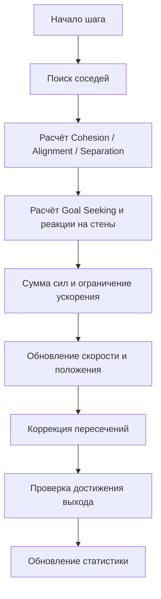

<div align="center">

# ЛАБОРАТОРНАЯ РАБОТА

## Моделирование коллективного поведения агентов

### Вариант № 3 — Моделирование движения пешеходов

**Алгоритм Boids с правилом движения к цели (Goal Seeking)**

---

**Студент:** Мартынюк Петр  
**Группа:** IA2404  
**Дисциплина:** Искусственный интеллект  
**Дата:** 30 октября 2026 г.

</div>

> **Кратко о работе.** Разработана интерактивная двумерная модель движения пешеходов из помещения через коридор и узкий выход. Поведение каждого агента определяется взаимодействием с соседями, стремлением к цели и ограничениями геометрии. Для анализа доступны показатели завершения эвакуации и локальных скоплений.

---

## 1. Цель работы

Исследовать поведение толпы в ограниченном пространстве с использованием алгоритма **Boids**, дополненного правилом **Goal Seeking**. Проверить, как количество пешеходов, плотность их начального размещения, ширина коридора и двери, а также сила разделения влияют на движение группы, появление очередей и время выхода.

## 2. Постановка задачи

Необходимо создать двумерную среду с коридором и выходом; задать набор пешеходов с начальными координатами и скоростями; на каждом шаге моделирования находить соседей, рассчитывать силы **Cohesion**, **Alignment**, **Separation** и **Goal Seeking**, суммировать их с весами и ограничивать скорость. Требуется анимация движения и фиксация времени достижения цели каждым участником.

В экспериментальной части следует сравнить сценарии с различным количеством людей, плотностью, шириной коридора, дверного проёма и силой разделения.

## 3. Модель и среда

### 3.1. Планировка

Пешеходы начинают движение в просторной левой комнате, проходят через вход в коридор, затем через более узкую дверь и достигают линии выхода справа.


Для расчётов используются координаты в **пикселях**, время измеряется в **модельных секундах**. Пешеход изображается кругом радиуса **7 px**.

### 3.2. Агенты

Каждый пешеход характеризуется:

| Поле | Содержание |
|:--|:--|
| `pid` | Уникальный номер агента |
| `x`, `y` | Положение в плоскости |
| `vx`, `vy` | Компоненты скорости |
| `exit_time` | Время достижения выхода; до выхода значение отсутствует |

Начальные позиции генерируются с учётом заданной плотности, начальные скорости равны нулю. Чтобы результаты можно было повторить, используется фиксированное случайное зерно `seed = 7`.

### 3.3. Управляемые параметры

| Параметр | Диапазон в панели | Назначение |
|:--|:--:|:--|
| Количество пешеходов | 20–80 | Размер группы |
| Начальная плотность | 0,00–1,00 | Компактность начального размещения |
| Ширина коридора | 32–250 px | Расстояние между стенами коридора |
| Ширина двери | 24–150 px | Ширина конечного проёма |
| Сила разделения | 0,00–5,00 | Интенсивность избегания соседей |

**Дополнительное ограничение:** ширина двери не может превышать ширину коридора.

Параметры движения, заданные в `Config`:

| Параметр | Значение |
|:--|--:|
| Радиус поиска соседей | 58 px |
| Радиус разделения | 22 px |
| Вес центрирования | 0,18 |
| Вес выравнивания | 0,28 |
| Вес движения к цели | 1,8 |
| Максимальная скорость | 115 px/с |
| Максимальное ускорение | 240 px/с² |
| Шаг времени | 1/30 с |
| Максимум шагов | 1800 |

## 4. Используемый алгоритм

### 4.1. Базовые правила Boids

1. **Cohesion (центрирование).** Пешеход немного корректирует движение в сторону средней позиции соседей.
2. **Alignment (выравнивание).** Пешеход стремится согласовать направление и скорость с ближайшими агентами.
3. **Separation (разделение).** При слишком близком расстоянии агент получает управляющий вектор, направленный от соседей.
4. **Goal Seeking (движение к цели).** Агент ориентируется на последовательные промежуточные точки: вход в коридор, дверь и линию выхода.

Дополнительно применяются отталкивание от стен и коррекция геометрических пересечений.

### 4.2. Расчёт движения

Суммарное управляющее воздействие представляется как взвешенная сумма:

\[
\vec a_{raw} = w_c\vec C + w_a\vec A + w_s\vec S + w_g\vec G + w_w\vec W,
\]

где `C` — центрирование, `A` — выравнивание, `S` — разделение, `G` — движение к цели, `W` — отталкивание от стен, а `w` — веса соответствующих правил.

Полученное ускорение ограничивается значением `max_acceleration`; затем обновляются скорость и положение:

\[
\vec v_{t+1}=\operatorname{limit}(\vec v_t+\vec a\Delta t, v_{max}),
\qquad
\vec p_{t+1}=\vec p_t+\vec v_{t+1}\Delta t.
\]

После предварительного обновления координат модель корректирует столкновения со стенами и контактирующими пешеходами. Такая коррекция уменьшает пересечения, но не превращает учебную модель в физически точный симулятор человеческого движения.

### 4.3. Порядок одного шага



## 5. Программная реализация

**Язык:** Python. **Графика и обработка событий:** Pygame Community Edition (`pygame-ce`). Для вычислений используются стандартные модули `math`, `random`; для сохранения статистики — `csv`.

| Компонент | Функция |
|:--|:--|
| `Config` | Хранит параметры эксперимента и движения |
| `Pedestrian` | Хранит состояние отдельного пешехода |
| `Simulation` | Создание группы, расчёт шага, статистика, экспорт |
| `ControlPanel` | Изменение параметров, проверка диапазонов, применение настроек |
| `draw()` | Отображение планировки, агентов и показателей |
| `main()` | Главный цикл приложения и обработка клавиш |

Для запуска в терминале VS Code:

```powershell
python -m pip install pygame-ce
python main.py
```

Панель содержит кнопки `−` и `+`, а также поля ручного ввода. Применение изменений перезапускает эксперимент. Клавиша **Space** управляет паузой, **R** перезапускает модель, **S** сохраняет `results.csv`.

## 6. Визуализация

Цвет пешехода показывает **локальную плотность окружения**, определяемую количеством соседей в радиусе 30 px:

| Цвет | Соседи | Значение |
|:--|:--:|:--|
| 🟢 Зелёный | 0–2 | Относительно свободное движение |
| 🟡 Жёлтый | 3–4 | Повышенная локальная плотность |
| 🔴 Красный | 5 и более | Скопление |

Эта цветовая шкала **не измеряет затор непосредственно**: плотность и остановка движения — разные признаки.

### Иллюстрация наблюдаемого сценария

![Пример симуляции: скопление перед узкой дверью]


*Рисунок 1 — Скриншот одного из пользовательских запусков до последней корректировки интерфейса. Видны отдельный коридор, узкая дверь и скопление людей перед проёмом. Изображение иллюстрирует поведение модели, а не окончательный дизайн интерфейса.*

## 7. Эксперименты

Для корректного сравнения параметров желательно изменять **по одному фактору**, сохраняя остальные постоянными. Следующие шесть конфигураций приведены в инструкции к проекту и предназначены для последовательной проверки влияний.

| № | Людей | Плотность | Коридор, px | Дверь, px | Разделение |
|---:|---:|---:|---:|---:|---:|
| 1 | 30 | 0,50 | 120 | 70 | 2,2 |
| 2 | 60 | 0,50 | 120 | 70 | 2,2 |
| 3 | 60 | 0,90 | 120 | 70 | 2,2 |
| 4 | 60 | 0,90 | 60 | 50 | 2,2 |
| 5 | 60 | 0,90 | 60 | 24 | 2,2 |
| 6 | 60 | 0,90 | 60 | 24 | 4,0 |

### 7.1. Зафиксированное наблюдение

В предоставленном скриншоте одного запуска указаны следующие показатели:

| Показатель | Значение |
|:--|--:|
| Пешеходов в начале | 20 |
| Начальная плотность | 1,00 |
| Ширина коридора | 120 px |
| Ширина двери | 24 px |
| Сила разделения | 0,00 |
| Пройдено шагов | 1800 из 1800 |
| Вышло | 10 |
| Осталось | 10 |
| Среднее время вышедших | 10,62 с |
| Наибольшее скопление у двери | 17 |
| Максимум соседей в радиусе 30 px | 12 |

**Наблюдение:** при узкой двери и нулевой силе разделения часть агентов не успела достичь выхода за отведённое число шагов. В кадре заметно скопление у дверного проёма. **Полное время выхода группы не определено**, поскольку вышли не все.

### 7.2. Таблица для фиксации остальных запусков

Пока не получены CSV-файлы или снимки статистики для шести сценариев, их численные результаты нельзя считать измеренными.

| № | Вышли / всего | Среднее время вышедших, с | Время всей группы, с | Макс. очередь | Макс. соседей |
|---:|:--:|--:|--:|--:|--:|
| 1 | — | — | — | — | — |
| 2 | — | — | — | — | — |
| 3 | — | — | — | — | — |
| 4 | — | — | — | — | — |
| 5 | — | — | — | — | — |
| 6 | — | — | — | — | — |

> **Как заполнять:** для каждого сценария задать параметры, запустить симуляцию, дождаться завершения и нажать **S**. Каждый сохранённый `results.csv` переименовать, например, в `experiment_01.csv`, иначе следующий экспорт заменит предыдущий файл.

### 7.3. Как анализировать результаты

- **Число пешеходов (1 → 2):** сравнить увеличение нагрузки при постоянной геометрии.
- **Начальная плотность (2 → 3):** проверить изменение локальных скоплений при том же количестве людей.
- **Коридор и дверь (3 → 4 → 5):** исследовать ограничение пропускной способности узких участков; здесь меняется геометрия последовательно, поэтому эффекты следует трактовать аккуратно.
- **Сила разделения (5 → 6):** сравнить, как усиление отталкивания влияет на плотность и завершение движения.

При незавершённой эвакуации нужно записывать «не завершена», а не подставлять среднее время вышедших как время всей группы.

## 8. Выводы

В ходе лабораторной работы разработана интерактивная 2D-модель пешеходного движения на основе **Boids** с дополнительным правилом **Goal Seeking**. Реализованы поиск соседей, центрирование, выравнивание, разделение, движение к промежуточным целям, реакция на стены и ограничения скорости и ускорения.

Модель позволяет менять количество агентов, компактность их начального размещения, ширину коридора, ширину выхода и вес правила разделения. Визуально отображаются локальные скопления, а статистика содержит число вышедших, время каждого вышедшего, максимальную очередь и плотность соседства.

На предоставленном запуске с **20 пешеходами**, **дверью 24 px** и **нулевой силой разделения** к концу **1800 шагов** половина группы оставалась внутри. Это демонстрирует возможность появления выраженного скопления в зоне узкого прохода. Для обоснованных сравнений между настройками необходимо выполнить серию экспериментов из раздела 7 и заполнить итоговую таблицу фактическими измерениями.

**Итог:** реализованная программа пригодна для учебного исследования коллективного движения и влияния ограничений среды, однако не предназначена для инженерного расчёта безопасности эвакуации.

---

<div align="center">

*Конец отчёта · Вариант № 3 · Boids для пешеходов*

</div>
